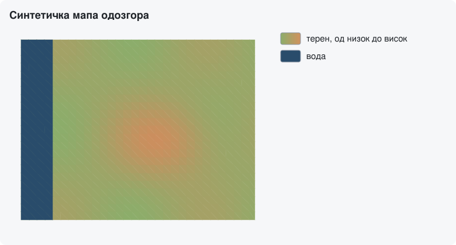

# Датотеките на нивото и рамките {#the-level-files-and-frames}

`<out>/<map>/<map>.glb` (нивото: 3D модел на теренот) и `<map>.json`
покрај него. glb се пишува во
`<map>.glb.part` и се преименува кога ќе заврши.

| Дел | Што е |
|---|---|
| `ground:<map>` | мапата на височини на теренот како мрежа, најмногу `--max-grid` примероци по страна (стандардно 1024: околу 2 милиони триаголници) |
| `water:<map>` | реки, езера и море: рамни четириаголници на висината на водата, по еден за секоја ќелија на мрежата за која доволно примероци од мапата на височини се под вода (третина со маската на вода на мапата, половина без неа) |
| `ground:<map> towns` | отпечатоците на изградените површини на градови и села, положени 1,5 m над теренот |

JSON ги содржи **аглите и кутијата за географска ширина/должина** на мапата (`corners`,
`extent`), како се најдени (`georeference`), поставките за височина
(`heightMul`, `SeaLevel`), просторот за игра во метри на играта (`playArea`), рамката
и нејзиното потекло (`frame`, `geo`), броеви на триаголници и сите `notes`.

## Рамки {#frames}

Две рамки, `--frame`:

- `enu` (стандардно): метри на исток, висина над морското ниво, на север од потекло на
  тангентната рамнина WGS-84: рамната мапа во која 3DHeat Watcher ја става снимката Tacview од IL-2
  (x исток, y висина, z север, исцртано со огледано z). glb
  складира (исток, висина, -север). Користете `--origin <lat> <lon>`, поставено на
  `geo` на снимката (референтната точка на нејзината сесија) и снимката се поставува на
  нивото без чекор за поставување; без тоа центарот на мапата е потеклото,
  а `geo` во JSON кажува кое.
- `game`: сопствените метри на играта како што ги имаат датотеките на мисиите: x на север од
  јужниот раб, y висината на играта, z на исток од западниот раб (десен координатен систем како што
  е, па glb = (x, y, z)). Мапите што не можат да се постават на земјата се пишуваат во
  оваа рамка како и да е побарано, со белешка.

Нивото е glTF бинарна датотека со именувани делови, како и секое ниво на 3DHeat; страницата
[Нивоа](https://holdi601.github.io/3DHeat/levels.html) на прегледувачот објаснува како ги вчитува.
