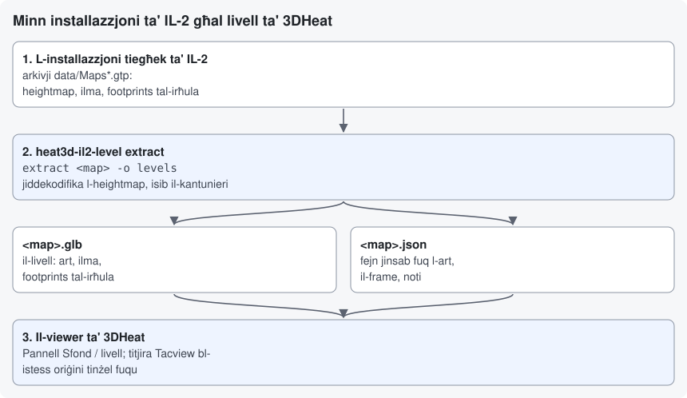

# 3DHeat IL-2 {#dheat-il-2}

**X'inhi?** Programm żgħir li jibdel il-mapep ta' **IL-2 Sturmovik:
Great Battles**, moqrija mill-**installazzjoni tiegħek stess**, f'mudelli 3D - livelli -
li tista' ttir fuqhom fil-viewer ta' [3DHeat](https://github.com/Holdi601/3DHeat)
([dokumentazzjoni](https://holdi601.github.io/3DHeat/)): l-għoljiet, ix-xmajjar,
il-lagi, il-baħar u l-irħula, imqiegħda fejn jinsabu fuq l-art. Logħba oħra ta' IL-2
li l-arkivji tagħha jaħbu t-tabella tal-fajls tagħhom tinqara safejn jippermettu
([dettalji](archives-without-table.md)).

**Għaliex nużaha?** Biex tara t-titjiriet tiegħek ta' IL-2 fuq il-mappa proprja tal-logħba.

**Eżempju:** `heat3d-il2-level extract <map> -o levels` ->
`levels/<map>/<map>.glb` (il-livell) + `<map>.json` (fejn jinsab fuq
l-art). Heightmap hija grilja ta' għoli, bħal mappa tar-rilief; reġistrazzjoni
Tacview hija fajl ta' titjira li jikteb Tacview.

Għal xiex hija utli:

- **Titjiriet fuq il-mappa proprja tal-logħba.** Reġistrazzjoni Tacview ta' IL-2, ikkonvertita
  mill-Watcher ta' 3DHeat bl-istess oriġini, tinżel fuq il-livell mingħajr
  pass ta' tqegħid.
- **Kull mappa f'daqqa.** `extract --all` jikteb kull mappa misjuba; l-istaġuni li
  jaqsmu heightmap jinkitbu darba.
- **Fejn fuq l-art.** Il-`.json` ta' kull livell iġorr il-kantunieri tiegħu u l-kaxxa
  tal-latitudni/lonġitudni, u kif instabu.



## Bidu veloċi {#quick-start}

Ġdid mal-linja tal-kmandi? Aqra [Qabel ma tibda](before-you-start.md) l-ewwel.
Ħaddem dawn fil-folder li kklonjajt jew ħlist miż-zip:

```bash
python -m pip install -e .                         # installs the heat3d-il2-level command
python -m pip install -e .[fast]                            # with numba: decoding 20 to 50 times faster
heat3d-il2-level list                              # every map found, with its latitude/longitude box
heat3d-il2-level extract <map> -o levels           # one map (names as `list` prints them, wildcards allowed)
heat3d-il2-level extract --all -o levels           # every map
```

Għandek tara linja għal kull mappa minn `list`, u `ok ...` minn `extract`.
Imbagħad tgħabbi `levels/<map>/<map>.glb` fil-pannell Sfond / livell tal-viewer
([Livelli](https://holdi601.github.io/3DHeat/levels.html)).

Il-livelli li tikteb huma mibnija mid-dejta tal-logħba: jibqgħu **fuq il-magna
tiegħek**; qatt ma tippubblikahom ([Termini](terms.md)).

Kull qarrej ta' logħba huwa proġett żgħir għalih, bil-fajl tal-liċenzja tiegħu, ir-rilaxxi tiegħu u s-sistema tal-kwistjonijiet tiegħu, sabiex ikun jista' jiġi installat, aġġornat, miżmum - jew irtirat fuq talba ta' detentur tad-drittijiet - waħdu, mingħajr ma jolqot lill-viewer jew l-għodod l-oħra.

## Paġni {#pages}

| Paġna | X'tkopri |
|---|---|
| [Qabel ma tibda](before-you-start.md) | Python, terminal, ewwel użu |
| [Insibu l-mapep: list](list.md) | fejn jinstabu l-installazzjonijiet, x'jistampa `list` |
| [Nibnu livelli: extract](extract.md) | kull għażla, pass b'pass, eżempji |
| [Il-fajls tal-livell u l-frames](output.md) | il-partijiet tal-`.glb`, il-`.json`, il-frames `enu` u `game` |
| [Kif jinqraw il-fajls](reading.md) | arkivji, il-codec tal-heightmap, ilma, irħula, landmark fits |
| [Arkivji mingħajr tabella tal-fajls](archives-without-table.md) | it-tieni logħba, moqrija safejn jippermettu l-arkivji tagħha |
| [Veloċità, testijiet, termini](terms.md) | numba, it-testijiet, x'jinqara u x'ma jintbagħatx, il-liċenzja |
| [Referenza tal-kmandi](../cli-reference.md) | kull għażla, iġġenerata mill-kodiċi |
| [Iżżomm dawn id-dokumenti](maintaining.md) | il-lista ta' kontroll tar-rilaxx |

## Relatat {#related}

- Il-viewer ta' 3DHeat: [github.com/Holdi601/3DHeat](https://github.com/Holdi601/3DHeat),
  dokumentazzjoni fuq [holdi601.github.io/3DHeat](https://holdi601.github.io/3DHeat/).
- Telemetrija għal dawn il-livelli: il-[Watcher ta' 3DHeat](https://holdi601.github.io/3DHeat-Watcher/)
  jikkonverti reġistrazzjonijiet Tacview ta' IL-2; il-formati tal-fajls tal-viewer, inkluż il-
  container ta' fajl wieħed għal kull partita, huma deskritti f'
  [Fajl wieħed għal kull partita (.3dheat)](https://holdi601.github.io/3DHeat/container.html).

## L-għodod ta' 3DHeat {#the-3dheat-tools}

| Għodda | X'tagħmel | Kodiċi | Dokumenti |
|---|---|---|---|
| 3DHeat viewer | juri d-dejta: heatmaps, analiżi tat-tlielaq, reviżjoni tal-partiti | [3DHeat](https://github.com/Holdi601/3DHeat) | [docs](https://holdi601.github.io/3DHeat/) |
| GameFiles | livelli u korsijiet mill-fajls proprji tal-logħba | [3DHeat-GameFiles](https://github.com/Holdi601/3DHeat-GameFiles) | [docs](https://holdi601.github.io/3DHeat-GameFiles/) |
| GameCapture | telemetrija tal-laps, u livelli mibnija mill-ġdid minn vidjo tal-logħba | [3DHeat-GameCapture](https://github.com/Holdi601/3DHeat-GameCapture) | [docs](https://holdi601.github.io/3DHeat-GameCapture/) |
| Unreal Exporter | plugin ta' Unreal Editor: livell bħala `.glb` wieħed | [3DHeat-UnrealExporter](https://github.com/Holdi601/3DHeat-UnrealExporter) | [docs](https://holdi601.github.io/3DHeat-UnrealExporter/) |
| CS2 | demos u mapep ta' Counter-Strike 2 | [3DHeat-CS2](https://github.com/Holdi601/3DHeat-CS2) | [docs](https://holdi601.github.io/3DHeat-CS2/) |
| Watcher | jirrekordja dak li l-logħob jippubblika waqt li tilgħab | [3DHeat-Watcher](https://github.com/Holdi601/3DHeat-Watcher) | [docs](https://holdi601.github.io/3DHeat-Watcher/) |
| Ext-WarThunder | replays ta' War Thunder | [3DHeat-Ext-WarThunder](https://github.com/Holdi601/3DHeat-Ext-WarThunder) | [docs](https://holdi601.github.io/3DHeat-Ext-WarThunder/) |
| Ext-WoT | replays ta' World of Tanks | [3DHeat-Ext-WoT](https://github.com/Holdi601/3DHeat-Ext-WoT) | [docs](https://holdi601.github.io/3DHeat-Ext-WoT/) |
| Ext-WoWs | replays ta' World of Warships | [3DHeat-Ext-WoWs](https://github.com/Holdi601/3DHeat-Ext-WoWs) | [docs](https://holdi601.github.io/3DHeat-Ext-WoWs/) |
| Ext-Squad | demos tas-server ta' Squad | [3DHeat-Ext-Squad](https://github.com/Holdi601/3DHeat-Ext-Squad) | [docs](https://holdi601.github.io/3DHeat-Ext-Squad/) |
| Ext-DCS | mapep ta' DCS World bħala livelli 3D | [3DHeat-Ext-DCS](https://github.com/Holdi601/3DHeat-Ext-DCS) | [docs](https://holdi601.github.io/3DHeat-Ext-DCS/) |
| Ext-IL2 | mapep ta' IL-2 Sturmovik bħala livelli 3D | [3DHeat-Ext-IL2](https://github.com/Holdi601/3DHeat-Ext-IL2) | [docs](https://holdi601.github.io/3DHeat-Ext-IL2/) |
