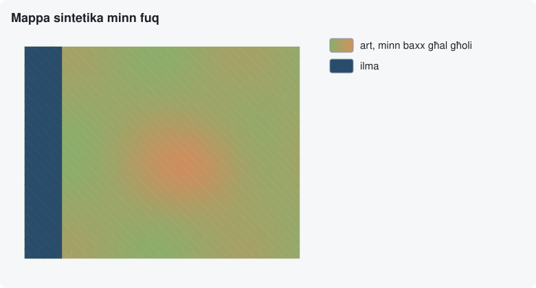

# Il-fajls tal-livell u l-frames {#the-level-files-and-frames}

`<out>/<map>/<map>.glb` (il-livell: mudell 3D tal-art) u `<map>.json`
ħdejh. Il-glb jinkiteb f'
`<map>.glb.part` u jinbidel isimu meta jkun komplut.

| Parti | X'inhi |
|---|---|
| `ground:<map>` | l-heightmap tat-terren bħala grilja, l-aktar `--max-grid` kampjuni kull naħa (default 1024: madwar 2 miljun trijangolu) |
| `water:<map>` | xmajjar, lagi u baħar: quads ċatti fl-għoli tal-ilma, wieħed għal kull ċellola tal-grilja li biżżejjed mill-kampjuni tal-heightmap tagħha huma taħt l-ilma (terz bil-water mask tal-mappa, nofs mingħajrha) |
| `ground:<map> towns` | il-footprints mibnija tal-bliet u l-irħula, imfassla 1.5 m fuq l-art |

Il-JSON iżomm il-**kantunieri u l-kaxxa tal-latitudni/lonġitudni** tal-mappa (`corners`,
`extent`), kif instabu (`georeference`), is-settings tal-għoli
(`heightMul`, `SeaLevel`), iż-żona tal-logħob fil-metri tal-logħba (`playArea`), il-
frame u l-oriġini tiegħu (`frame`, `geo`), l-għadd tat-trijangoli u kwalunkwe `notes`.

## Frames {#frames}

Żewġ frames, `--frame`:

- `enu` (default): metri lvant, altitudni fuq il-livell tal-baħar, tramuntana minn oriġini fuq
  il-pjan tanġenti WGS-84: il-mappa ċatta li fiha l-Watcher ta' 3DHeat iqiegħed reġistrazzjoni
  Tacview ta' IL-2 (x lvant, y altitudni, z tramuntana, imfassla b'z mirja). Il-glb
  iżomm (lvant, altitudni, -tramuntana). Ikkonverti b'`--origin <lat> <lon>` issettjat għall-`geo` ta'
  reġistrazzjoni (il-punt ta' referenza tas-sessjoni tagħha) u r-reġistrazzjoni tinżel fuq
  il-livell mingħajr pass ta' tqegħid; mingħajru ċ-ċentru tal-mappa huwa l-oriġini,
  u l-`geo` tal-JSON jgħid liema.
- `game`: il-metri proprji tal-logħba kif għandhom il-fajls tal-missjonijiet: x tramuntana mill-
  tarf tan-nofsinhar, y l-għoli tal-logħba, z lvant mill-tarf tal-punent (right-handed kif
  inhu, għalhekk glb = (x, y, z)). Mapep li ma jistgħux jitqiegħdu fuq l-art jinkitbu f'
  dan il-frame minkejja dak mitlub, b'nota.

Il-livell huwa glTF binarju b'partijiet bl-isem, kif inhu kull livell ta' 3DHeat; il-paġna
[Livelli](https://holdi601.github.io/3DHeat/levels.html) tal-viewer tgħid kif jgħabbihom.
