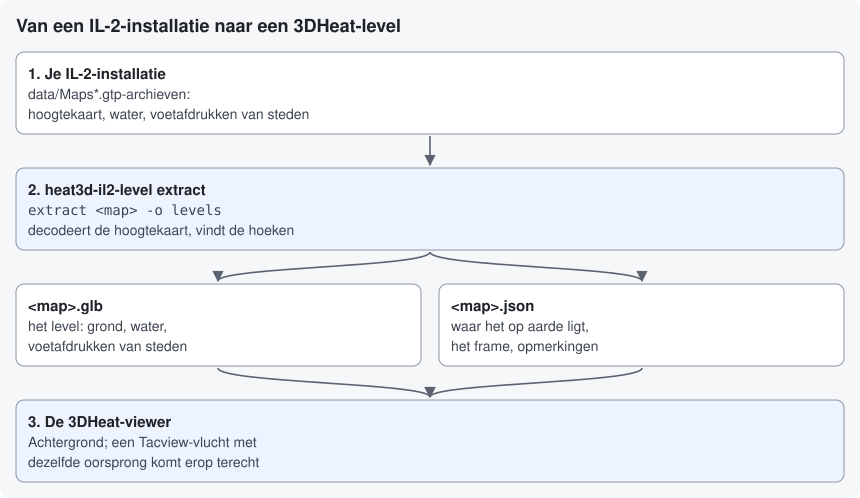

# 3DHeat IL-2 {#dheat-il-2}

**Wat is het?** Een klein programma dat de kaarten van **IL-2 Sturmovik:
Great Battles**, gelezen uit **je eigen installatie**, omzet in 3D-modellen - levels -
waarboven je kunt vliegen in de [3DHeat](https://github.com/Holdi601/3DHeat)-viewer
([documentatie](https://holdi601.github.io/3DHeat/)): de heuvels, rivieren,
meren, zee en steden, geplaatst waar ze op aarde liggen. Een tweede IL-2-spel
waarvan de archieven hun bestandstabel verbergen, wordt gelezen voor zover de archieven dat toelaten
([details](archives-without-table.md)).

**Waarom zou ik het gebruiken?** Om je IL-2-vluchten te zien op de eigen kaart van het spel.

**Voorbeeld:** `heat3d-il2-level extract <map> -o levels` ->
`levels/<map>/<map>.glb` (het level) + `<map>.json` (waar het op aarde ligt). Een hoogtekaart is een raster van
hoogten, als een reliëfkaart; een Tacview-opname is een bestand van een vlucht dat Tacview schrijft.

Waarvoor het nuttig is:

- **Vluchten op de eigen kaart van het spel.** Een IL-2 Tacview-opname, omgezet door de
  3DHeat Watcher met dezelfde oorsprong, komt op het level terecht zonder plaatsingsstap.
- **Elke kaart tegelijk.** `extract --all` schrijft elke gevonden kaart; seizoenen die
  een hoogtekaart delen, worden één keer geschreven.
- **Waar op aarde.** De `.json` van elk level bevat zijn hoeken en het vak in breedte-/lengtegraad,
  en hoe ze zijn gevonden.



## Snelstart {#quick-start}

Nog nooit met de opdrachtregel gewerkt? Lees eerst [Voordat je begint](before-you-start.md).
Voer deze opdrachten uit in de map waarin je hebt gekloond of uitgepakt:

```bash
python -m pip install -e .                         # installeert het commando heat3d-il2-level
python -m pip install -e .[fast]                            # met numba: decoderen 20 tot 50 keer sneller
heat3d-il2-level list                              # elke gevonden kaart, met zijn vak in breedte-/lengtegraad
heat3d-il2-level extract <map> -o levels           # één kaart (namen zoals `list` ze afdrukt, jokertekens toegestaan)
heat3d-il2-level extract --all -o levels           # elke kaart
```

Je ziet een regel per kaart van `list`, en `ok ...` van `extract`.
Laad daarna `levels/<map>/<map>.glb` in het paneel Achtergrond / level van de viewer
([Levels](https://holdi601.github.io/3DHeat/levels.html)).

De levels die het schrijft, zijn gemaakt uit de gegevens van het spel: ze blijven **op jouw
computer**; publiceer ze nooit ([Voorwaarden](terms.md)).

## Pagina's {#pages}

| Pagina | Wat die behandelt |
|---|---|
| [Voordat je begint](before-you-start.md) | Python, een terminal, een eerste keer draaien |
| [Kaarten zoeken: list](list.md) | waar de installaties worden gevonden, wat `list` afdrukt |
| [Levels bouwen: extract](extract.md) | elke optie, stap voor stap, voorbeelden |
| [De levelbestanden en frames](output.md) | de `.glb`-onderdelen, de `.json`, de `enu`- en `game`-frames |
| [Hoe de bestanden worden gelezen](reading.md) | archieven, de hoogtekaartcodec, water, steden, oriëntatiepuntenpassingen |
| [Archieven zonder bestandstabel](archives-without-table.md) | het tweede spel, gelezen voor zover de archieven dat toelaten |
| [Snelheid, tests, voorwaarden](terms.md) | numba, de tests, de voorwaarden van het spel, licentie |
| [Commandoreferentie](../cli-reference.md) | elke optie, gegenereerd uit de code |
| [Deze documentatie onderhouden](maintaining.md) | de checklist per release |

## Verwant {#related}

- De 3DHeat-viewer: [github.com/Holdi601/3DHeat](https://github.com/Holdi601/3DHeat),
  documentatie op [holdi601.github.io/3DHeat](https://holdi601.github.io/3DHeat/).
- Telemetrie voor deze levels: de [3DHeat Watcher](https://holdi601.github.io/3DHeat-Watcher/)
  zet IL-2 Tacview-opnamen om; de bestandsformaten van de viewer, waaronder de container met
  één bestand per wedstrijd, staan beschreven in
  [Eén bestand per wedstrijd (.3dheat)](https://holdi601.github.io/3DHeat/container.html).

## De 3DHeat-tools {#the-3dheat-tools}

| Tool | Wat die doet | Code | Documentatie |
|---|---|---|---|
| 3DHeat-viewer | toont de gegevens: heatmaps, Race-analyse, wedstrijdanalyse | [3DHeat](https://github.com/Holdi601/3DHeat) | [documentatie](https://holdi601.github.io/3DHeat/) |
| GameFiles | levels en banen uit de eigen bestanden van een spel | [3DHeat-GameFiles](https://github.com/Holdi601/3DHeat-GameFiles) | [documentatie](https://holdi601.github.io/3DHeat-GameFiles/) |
| GameCapture | telemetrie van rondes, en levels opnieuw opgebouwd uit gameplayvideo | [3DHeat-GameCapture](https://github.com/Holdi601/3DHeat-GameCapture) | [documentatie](https://holdi601.github.io/3DHeat-GameCapture/) |
| Unreal Exporter | een plug-in voor de Unreal Editor: een level als één `.glb` | [3DHeat-UnrealExporter](https://github.com/Holdi601/3DHeat-UnrealExporter) | [documentatie](https://holdi601.github.io/3DHeat-UnrealExporter/) |
| CS2 | Counter-Strike 2-demo's en -kaarten | [3DHeat-CS2](https://github.com/Holdi601/3DHeat-CS2) | [documentatie](https://holdi601.github.io/3DHeat-CS2/) |
| Watcher | legt vast wat games publiceren terwijl je speelt | [3DHeat-Watcher](https://github.com/Holdi601/3DHeat-Watcher) | [documentatie](https://holdi601.github.io/3DHeat-Watcher/) |
| Ext-WarThunder | War Thunder-replays | [3DHeat-Ext-WarThunder](https://github.com/Holdi601/3DHeat-Ext-WarThunder) | [documentatie](https://holdi601.github.io/3DHeat-Ext-WarThunder/) |
| Ext-WoT | World of Tanks-replays | [3DHeat-Ext-WoT](https://github.com/Holdi601/3DHeat-Ext-WoT) | [documentatie](https://holdi601.github.io/3DHeat-Ext-WoT/) |
| Ext-WoWs | World of Warships-replays | [3DHeat-Ext-WoWs](https://github.com/Holdi601/3DHeat-Ext-WoWs) | [documentatie](https://holdi601.github.io/3DHeat-Ext-WoWs/) |
| Ext-Squad | Squad-serverdemo's | [3DHeat-Ext-Squad](https://github.com/Holdi601/3DHeat-Ext-Squad) | [documentatie](https://holdi601.github.io/3DHeat-Ext-Squad/) |
| Ext-DCS | DCS World-kaarten als 3D-levels | [3DHeat-Ext-DCS](https://github.com/Holdi601/3DHeat-Ext-DCS) | [documentatie](https://holdi601.github.io/3DHeat-Ext-DCS/) |
| Ext-IL2 | IL-2 Sturmovik-kaarten als 3D-levels | [3DHeat-Ext-IL2](https://github.com/Holdi601/3DHeat-Ext-IL2) | [documentatie](https://holdi601.github.io/3DHeat-Ext-IL2/) |
