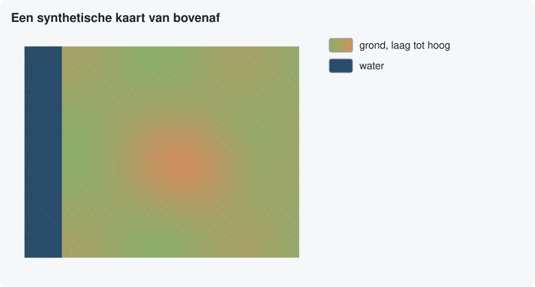

# De levelbestanden en frames {#the-level-files-and-frames}

`<out>/<map>/<map>.glb` (het level: een 3D-model van de grond) en `<map>.json`
ernaast. De glb wordt geschreven naar
`<map>.glb.part` en hernoemd wanneer hij klaar is.

| Onderdeel | Wat het is |
|---|---|
| `ground:<map>` | de hoogtekaart van het terrein als raster, met maximaal `--max-grid` monsters per zijde (standaard 1024: ongeveer 2 miljoen driehoeken) |
| `water:<map>` | rivieren, meren en zee: vlakke vierhoeken op de hoogte van het water, één per rastercel als genoeg van de hoogtekaartmonsters eronder liggen (een derde met het watermasker van de kaart, de helft zonder) |
| `ground:<map> towns` | de bebouwde voetafdrukken van steden en dorpen, 1,5 m boven de grond gedrapeerd |

De JSON bevat de **hoeken en het vak in breedte-/lengtegraad** van de kaart (`corners`,
`extent`), hoe ze zijn gevonden (`georeference`), de hooginstellingen
(`heightMul`, `SeaLevel`), het speelgebied in de meters van het spel (`playArea`), het
frame en zijn oorsprong (`frame`, `geo`), aantallen driehoeken en eventuele `notes`.

## Frames {#frames}

Twee frames, `--frame`:

- `enu` (standaard): meters oostwaarts, hoogte boven zeeniveau, noordwaarts vanaf een oorsprong op
  het raakvlak van WGS-84: de vlakke kaart waarin de 3DHeat Watcher een Tacview-opname van IL-2 zet
  (x oost, y hoogte, z noord, getekend met z gespiegeld). De glb
  slaat (oost, hoogte, -noord) op. Converteer met `--origin <lat> <lon>` ingesteld op de
  `geo` van een opname (het referentiepunt van zijn sessie) en de opname komt op
  het level terecht zonder plaatsingsstap; zonder dit is het midden van de kaart de oorsprong,
  en de `geo` in de JSON zegt welke.
- `game`: de eigen meters van het spel, zoals missiebestanden ze hebben: x noord vanaf de zuidrand, y de
  eigen hoogte van het spel, z oost vanaf de westrand (rechtshandig zoals het is, dus glb = (x, y, z)).
  Kaarten die niet op de aarde geplaatst kunnen worden, worden altijd in dit frame geschreven, wat er ook gevraagd is,
  met een opmerking.

Het level is een glTF-binair bestand met benoemde onderdelen, zoals elk 3DHeat-level; de pagina
[Levels](https://holdi601.github.io/3DHeat/levels.html) van de viewer zegt hoe het ze laadt.
