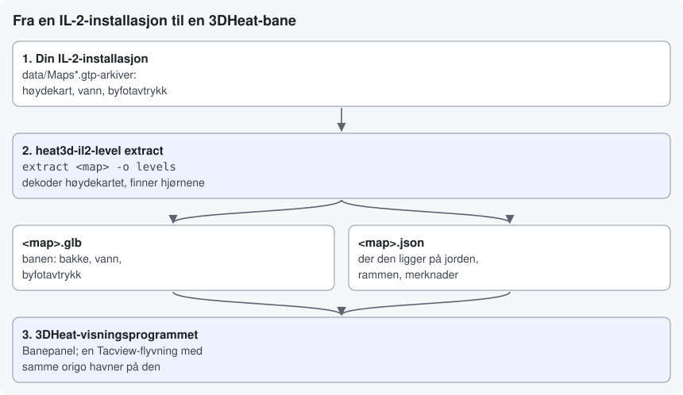

# 3DHeat IL-2 {#dheat-il-2}

**Hva er det?** Et lite program som gjør kartene i **IL-2 Sturmovik:
Great Battles**, lest fra **din egen installasjon**, om til 3D-modeller - baner -
du kan fly over i [3DHeat](https://github.com/Holdi601/3DHeat)-visningsprogrammet
([dokumentasjon](https://holdi601.github.io/3DHeat/)): åsene, elvene,
innsjøene, havet og byene, plassert der de ligger på jorden. Et andre IL-2-spill
der arkivene skjuler filtabellen deres, leses så langt arkivene tillater
([detaljer](archives-without-table.md)).

**Hvorfor skulle jeg bruke det?** For å se dine IL-2-flyvninger over spillets eget kart.

**Eksempel:** `heat3d-il2-level extract <map> -o levels` ->
`levels/<map>/<map>.glb` (banen) + `<map>.json` (hvor den ligger på
jorden). Et høydekart er et rutenett av høyder, som et relieffkart; et Tacview-
opptak er en fil med en flyvning som Tacview skriver.

Til hva det er nyttig:

- **Flyvninger over spillets eget kart.** Et IL-2 Tacview-opptak, konvertert av
  3DHeat Watcher med samme origo, havner på banen uten plasseringssteg.
- **Alle kart på en gang.** `extract --all` skriver hvert kart som finnes; sesonger som deler et
  høydekart skrives én gang.
- **Hvor på jorden.** Hver banes `.json` bærer sine hjørner og boksen i breddegrad/lengdegrad,
  og hvordan de ble funnet.



## Hurtigstart {#quick-start}

Ny til kommandolinjen? Les [Før du begynner](before-you-start.md) først.
Kjør disse i mappen du klonet eller pakket ut:

```bash
python -m pip install -e .                         # installs the heat3d-il2-level command
python -m pip install -e .[fast]                            # with numba: decoding 20 to 50 times faster
heat3d-il2-level list                              # every map found, with its latitude/longitude box
heat3d-il2-level extract <map> -o levels           # one map (names as `list` prints them, wildcards allowed)
heat3d-il2-level extract --all -o levels           # every map
```

Du bør se en linje per kart fra `list`, og `ok ...` fra `extract`.
Last deretter inn `levels/<map>/<map>.glb` i visningsprogrammets Bane-panel
([Baner](https://holdi601.github.io/3DHeat/levels.html)).

Banene den skriver er laget av spillets data: de blir **på din egen
maskin**; publiser dem aldri ([Vilkår](terms.md)).

## Sider {#pages}

| Side | Hva den dekker |
|---|---|
| [Før du begynner](before-you-start.md) | Python, en terminal, en første kjøring |
| [Finne kart: list](list.md) | hvor installasjonene finnes, hva `list` skriver ut |
| [Bygge baner: extract](extract.md) | hvert alternativ, steg for steg, eksempler |
| [Banefilene og rammene](output.md) | `.glb`-delene, `.json`, `enu`- og `game`-rammene |
| [Slik leses filene](reading.md) | arkiver, høydekartkodeken, vann, byer, landemerketilpasninger |
| [Arkiver uten filtabell](archives-without-table.md) | det andre spillet, lest så langt arkivene tillater |
| [Fart, tester, vilkår](terms.md) | numba, testene, spillets vilkår, lisens |
| [Kommandoreferanse](../cli-reference.md) | hvert alternativ, generert fra koden |
| [Vedlikehold av disse dokumentene](maintaining.md) | sjekklisten for utgivelse |

## Relatert {#related}

- 3DHeat-visningsprogrammet: [github.com/Holdi601/3DHeat](https://github.com/Holdi601/3DHeat),
  dokumentasjon på [holdi601.github.io/3DHeat](https://holdi601.github.io/3DHeat/).
- Telemetri for disse banene: [3DHeat Watcher](https://holdi601.github.io/3DHeat-Watcher/)
  konverterer IL-2 Tacview-opptak; visningsprogrammets filformater, inkludert beholderen med én fil per
  kamp, er beskrevet i [Én fil per kamp (.3dheat)](https://holdi601.github.io/3DHeat/container.html).

## 3DHeat-verktøyene {#the-3dheat-tools}

| Verktøy | Hva det gjør | Kode | Dokumentasjon |
|---|---|---|---|
| 3DHeat-visningsprogram | viser dataene: varmekart, løpsanalyse, kampgjennomgang | [3DHeat](https://github.com/Holdi601/3DHeat) | [dokumentasjon](https://holdi601.github.io/3DHeat/) |
| GameFiles | baner og løyper fra et spills egne filer | [3DHeat-GameFiles](https://github.com/Holdi601/3DHeat-GameFiles) | [dokumentasjon](https://holdi601.github.io/3DHeat-GameFiles/) |
| GameCapture | telemetri fra runder, og baner bygget opp fra spillopptak | [3DHeat-GameCapture](https://github.com/Holdi601/3DHeat-GameCapture) | [dokumentasjon](https://holdi601.github.io/3DHeat-GameCapture/) |
| Unreal Exporter | en Unreal Editor-plugin: en bane som én `.glb` | [3DHeat-UnrealExporter](https://github.com/Holdi601/3DHeat-UnrealExporter) | [dokumentasjon](https://holdi601.github.io/3DHeat-UnrealExporter/) |
| CS2 | Counter-Strike 2-demoer og kart | [3DHeat-CS2](https://github.com/Holdi601/3DHeat-CS2) | [dokumentasjon](https://holdi601.github.io/3DHeat-CS2/) |
| Watcher | tar opp det spill publiserer mens du spiller | [3DHeat-Watcher](https://github.com/Holdi601/3DHeat-Watcher) | [dokumentasjon](https://holdi601.github.io/3DHeat-Watcher/) |
| Ext-WarThunder | War Thunder-replayer | [3DHeat-Ext-WarThunder](https://github.com/Holdi601/3DHeat-Ext-WarThunder) | [dokumentasjon](https://holdi601.github.io/3DHeat-Ext-WarThunder/) |
| Ext-WoT | World of Tanks-replayer | [3DHeat-Ext-WoT](https://github.com/Holdi601/3DHeat-Ext-WoT) | [dokumentasjon](https://holdi601.github.io/3DHeat-Ext-WoT/) |
| Ext-WoWs | World of Warships-replayer | [3DHeat-Ext-WoWs](https://github.com/Holdi601/3DHeat-Ext-WoWs) | [dokumentasjon](https://holdi601.github.io/3DHeat-Ext-WoWs/) |
| Ext-Squad | Squad-serverdemoer | [3DHeat-Ext-Squad](https://github.com/Holdi601/3DHeat-Ext-Squad) | [dokumentasjon](https://holdi601.github.io/3DHeat-Ext-Squad/) |
| Ext-DCS | DCS World-kart som 3D-baner | [3DHeat-Ext-DCS](https://github.com/Holdi601/3DHeat-Ext-DCS) | [dokumentasjon](https://holdi601.github.io/3DHeat-Ext-DCS/) |
| Ext-IL2 | IL-2 Sturmovik-kart som 3D-baner | [3DHeat-Ext-IL2](https://github.com/Holdi601/3DHeat-Ext-IL2) | [dokumentasjon](https://holdi601.github.io/3DHeat-Ext-IL2/) |
