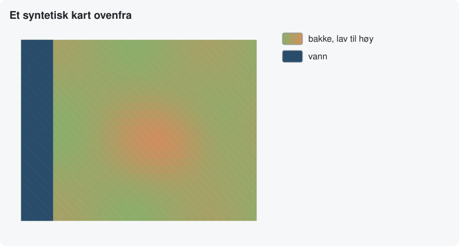

# Banefilene og rammene {#the-level-files-and-frames}

`<out>/<map>/<map>.glb` (banen: en 3D-modell av bakken) og `<map>.json`
ved siden av den. glb-filen skrives til
`<map>.glb.part` og gis nytt navn når den er ferdig.

| Del | Hva den er |
|---|---|
| `ground:<map>` | terrengets høydekart som et rutenett, på det meste `--max-grid`-prøver per side (standard 1024: omtrent 2 millioner trekanter) |
| `water:<map>` | elver, innsjøer og hav: flate firkanter i vannets høyde, én per rutecelle der nok av høydekartprøvene er under vann (en tredjedel med kartets vannmaske, halvparten uten) |
| `ground:<map> towns` | byenes og landsbyenes bebygde fotavtrykk, hengt 1,5 m over bakken |

JSON-filen holder kartets **hjørner og breddegrad/lengdegrad-boks** (`corners`,
`extent`), hvordan de ble funnet (`georeference`), høyde-innstillingene
(`heightMul`, `SeaLevel`), spillområdet i spillets meter (`playArea`), rammen
og dens origo (`frame`, `geo`), antall trekanter og eventuelle `notes`.

## Rammer {#frames}

To rammer, `--frame`:

- `enu` (standard): meter øst, høyde over havet, nord fra en origo på
  WGS-84-tangentplanet: det flate kartet som 3DHeat Watcher legger et IL-2 Tacview-
  opptak i (x øst, y høyde, z nord, tegnet med z speilvendt). glb-filen
  lagrer (øst, høyde, -nord). Konverter med `--origin <lat> <lon>` satt til et
  opptaks `geo` (øktens referansepunkt), så havner opptaket på banen uten
  plasseringssteg; uten den er kartets senter origo, og JSON-filens `geo` sier hvilket.
- `game`: spillets egne meter slik oppdragsfilene har dem: x nord fra sørkanten, y spillets
  høyde, z øst fra vestkanten (høyrehåndet slik den er, så glb = (x, y, z)). Kart som ikke kan
  plasseres på jorden skrives i denne rammen uansett hva som er bedt om, med en merknad.

Banen er en glTF-binærfil med navngitte deler, slik alle 3DHeat-baner er; visningsprogrammets
[Baner](https://holdi601.github.io/3DHeat/levels.html)-side sier hvordan de lastes inn.
