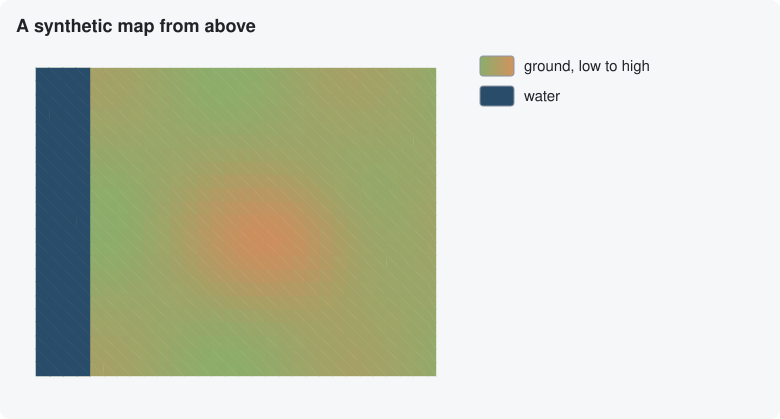

# The level files and frames

`<out>/<map>/<map>.glb` (the level: a 3D model of the ground) and `<map>.json`
beside it. The glb is written to
`<map>.glb.part` and renamed when complete.

| Part | What it is |
|---|---|
| `ground:<map>` | the terrain heightmap as a grid, at most `--max-grid` samples a side (default 1024: about 2 million triangles) |
| `water:<map>` | rivers, lakes and sea: flat quads at the water's height, one per grid cell enough of whose heightmap samples are under water (a third with the map's water mask, half without) |
| `ground:<map> towns` | the built-up footprints of towns and villages, draped 1.5 m over the ground |

The JSON holds the map's **corners and latitude/longitude box** (`corners`,
`extent`), how they were found (`georeference`), the height settings
(`heightMul`, `SeaLevel`), the play area in the game's metres (`playArea`), the
frame and its origin (`frame`, `geo`), triangle counts and any `notes`.

## Frames

Two frames, `--frame`:

- `enu` (default): metres east, altitude above sea level, north of an origin on
  the WGS-84 tangent plane: the flat map the 3DHeat Watcher puts an IL-2 Tacview
  recording in (x east, y altitude, z north, drawn with z mirrored). The glb
  stores (east, altitude, -north). Convert with `--origin <lat> <lon>` set to a
  recording's `geo` (its session's reference point) and the recording lands on
  the level with no placement step; without it the map's centre is the origin,
  and the JSON's `geo` says which.
- `game`: the game's own metres as mission files have them: x north from the
  south edge, y the game's height, z east from the west edge (right-handed as it
  is, so glb = (x, y, z)). Maps that cannot be placed on the earth are written in
  this frame whatever was asked, with a note.

The level is a glTF binary with named parts, as every 3DHeat level is; the viewer's
[Levels](https://holdi601.github.io/3DHeat/levels.html) page says how it loads them.
