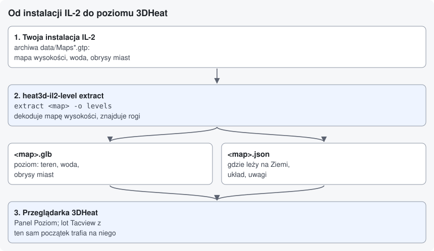

# 3DHeat IL-2 {#dheat-il-2}

**Czym jest?** Mały program, który zamienia mapy **IL-2 Sturmovik: Great Battles**, odczytane z **twojej
własnej instalacji**, w modele 3D - poziomy - nad którymi można latać w przeglądarce [3DHeat](https://github.com/Holdi601/3DHeat)
([dokumentacja](https://holdi601.github.io/3DHeat/)): wzgórza, rzeki, jeziora, morze i miasta, umieszczone tam,
gdzie leżą na Ziemi. Druga gra IL-2, której archiwa ukrywają tabelę plików, jest odczytywana tak daleko, jak na to pozwalają
([szczegóły](archives-without-table.md)).

**Po co go używać?** Żeby zobaczyć swoje loty IL-2 na samej mapie gry.

**Przykład:** `heat3d-il2-level extract <map> -o levels` ->
`levels/<map>/<map>.glb` (poziom) + `<map>.json` (gdzie leży na Ziemi). Mapa wysokości to siatka wysokości,
jak mapa reliefu; nagranie Tacview to plik lotu zapisany przez Tacview.

Do czego się przydaje:

- **Loty na mapie samej gry.** Nagranie Tacview z IL-2, przekonwertowane przez 3DHeat Watcher z tym samym punktem
  początkowym, ląduje na poziomie bez kroku ustawiania.
- **Wszystkie mapy naraz.** `extract --all` zapisuje każdą znalezioną mapę; pory roku, które współdzielą mapę wysokości,
  zapisuje się raz.
- **Gdzie na Ziemi.** `.json` każdego poziomu niesie jego rogi i prostokąt szerokości/długości geograficznej oraz to, jak je wyznaczono.



## Szybki start {#quick-start}

Nigdy nie używałeś wiersza poleceń? Najpierw przeczytaj [Zanim zaczniesz](before-you-start.md).
Uruchom te polecenia w folderze, do którego sklonowałeś albo rozpakowałeś narzędzie:

```bash
python -m pip install -e .                         # instaluje polecenie heat3d-il2-level
python -m pip install -e .[fast]                            # z numba: dekodowanie 20 do 50 razy szybciej
heat3d-il2-level list                              # każda znaleziona mapa, z jej prostokątem szerokości/długości geograficznej
heat3d-il2-level extract <map> -o levels           # jedna mapa (nazwy tak, jak wypisuje je `list`, symbole wieloznaczne dozwolone)
heat3d-il2-level extract --all -o levels           # każda mapa
```

Z `list` zobaczysz linię na mapę, a z `extract` - `ok ...`.
Potem wczytaj `levels/<map>/<map>.glb` w panelu **Tło / poziom** przeglądarki
([Poziomy](https://holdi601.github.io/3DHeat/levels.html)).

Poziomy, które narzędzie zapisuje, są zbudowane z danych gry: zostają **na twoim komputerze**;
nigdy ich nie publikuj ([Warunki](terms.md)).

## Strony {#pages}

| Strona | Czego dotyczy |
|---|---|
| [Zanim zaczniesz](before-you-start.md) | Python, terminal, pierwsze uruchomienie |
| [Szukanie map: list](list.md) | gdzie szukane są instalacje, co wypisuje `list` |
| [Budowanie poziomów: extract](extract.md) | każda opcja, krok po kroku, przykłady |
| [Pliki poziomu i układy](output.md) | części `.glb`, `.json`, układy `enu` i `game` |
| [Jak czytane są pliki](reading.md) | archiwa, kodek mapy wysokości, woda, miasta, dopasowania do punktów orientacyjnych |
| [Archiwa bez tabeli plików](archives-without-table.md) | druga gra, odczytana tak daleko, jak pozwalają archiwa |
| [Szybkość, testy, warunki](terms.md) | numba, testy, warunki gry, licencja |
| [Opis poleceń](../cli-reference.md) | każda opcja, generowana z kodu |
| [Utrzymanie tych stron](maintaining.md) | lista kontrolna wydania |

## Powiązane {#related}

- Przeglądarka 3DHeat: [github.com/Holdi601/3DHeat](https://github.com/Holdi601/3DHeat),
  dokumentacja na [holdi601.github.io/3DHeat](https://holdi601.github.io/3DHeat/).
- Telemetria dla tych poziomów: [3DHeat Watcher](https://holdi601.github.io/3DHeat-Watcher/)
  konwertuje nagrania Tacview z IL-2; formaty plików przeglądarki, w tym kontener jednego pliku na mecz,
  opisano w [Jeden plik na mecz (.3dheat)](https://holdi601.github.io/3DHeat/container.html).

## Narzędzia 3DHeat {#the-3dheat-tools}

| Narzędzie | Co robi | Kod | Dokumentacja |
|---|---|---|---|
| przeglądarka 3DHeat | pokazuje dane: mapy cieplne, analizę wyścigów, przegląd meczu | [3DHeat](https://github.com/Holdi601/3DHeat) | [dokumentacja](https://holdi601.github.io/3DHeat/) |
| GameFiles | poziomy i trasy z plików samej gry | [3DHeat-GameFiles](https://github.com/Holdi601/3DHeat-GameFiles) | [dokumentacja](https://holdi601.github.io/3DHeat-GameFiles/) |
| GameCapture | telemetria okrążeń i poziomy odtworzone z nagrań rozgrywki | [3DHeat-GameCapture](https://github.com/Holdi601/3DHeat-GameCapture) | [dokumentacja](https://holdi601.github.io/3DHeat-GameCapture/) |
| Unreal Exporter | wtyczka do edytora Unreal: poziom jako jeden plik `.glb` | [3DHeat-UnrealExporter](https://github.com/Holdi601/3DHeat-UnrealExporter) | [dokumentacja](https://holdi601.github.io/3DHeat-UnrealExporter/) |
| CS2 | dema i mapy Counter-Strike 2 | [3DHeat-CS2](https://github.com/Holdi601/3DHeat-CS2) | [dokumentacja](https://holdi601.github.io/3DHeat-CS2/) |
| Watcher | zapisuje to, co gry publikują podczas grania | [3DHeat-Watcher](https://github.com/Holdi601/3DHeat-Watcher) | [dokumentacja](https://holdi601.github.io/3DHeat-Watcher/) |
| Ext-WarThunder | replaye War Thunder | [3DHeat-Ext-WarThunder](https://github.com/Holdi601/3DHeat-Ext-WarThunder) | [dokumentacja](https://holdi601.github.io/3DHeat-Ext-WarThunder/) |
| Ext-WoT | replaye World of Tanks | [3DHeat-Ext-WoT](https://github.com/Holdi601/3DHeat-Ext-WoT) | [dokumentacja](https://holdi601.github.io/3DHeat-Ext-WoT/) |
| Ext-WoWs | replaye World of Warships | [3DHeat-Ext-WoWs](https://github.com/Holdi601/3DHeat-Ext-WoWs) | [dokumentacja](https://holdi601.github.io/3DHeat-Ext-WoWs/) |
| Ext-Squad | dema z serwerów Squad | [3DHeat-Ext-Squad](https://github.com/Holdi601/3DHeat-Ext-Squad) | [dokumentacja](https://holdi601.github.io/3DHeat-Ext-Squad/) |
| Ext-DCS | mapy DCS World jako poziomy 3D | [3DHeat-Ext-DCS](https://github.com/Holdi601/3DHeat-Ext-DCS) | [dokumentacja](https://holdi601.github.io/3DHeat-Ext-DCS/) |
| Ext-IL2 | mapy IL-2 Sturmovik jako poziomy 3D | [3DHeat-Ext-IL2](https://github.com/Holdi601/3DHeat-Ext-IL2) | [dokumentacja](https://holdi601.github.io/3DHeat-Ext-IL2/) |
