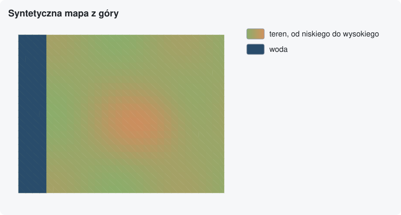

# Pliki poziomu i układy {#the-level-files-and-frames}

`<out>/<map>/<map>.glb` (poziom: model 3D terenu) i obok niego `<map>.json`.
Plik glb jest zapisywany jako `<map>.glb.part` i zmieniany na właściwą nazwę po zakończeniu.

| Część | Co to jest |
|---|---|
| `ground:<map>` | mapa wysokości jako siatka, najwyżej `--max-grid` próbek na bok (domyślnie 1024: około 2 milionów trójkątów) |
| `water:<map>` | rzeki, jeziora i morze: płaskie czworokąty na wysokości wody, po jednym na komórkę siatki, gdy wystarczająco dużo próbek mapy wysokości leży pod wodą (jedna trzecia z maską wody mapy, połowa bez niej) |
| `ground:<map> towns` | zabudowane obrysy miast i wsi, położone 1,5 m nad terenem |

`.json` niesie **rogi mapy i prostokąt szerokości/długości geograficznej** (`corners`,
`extent`), to, jak je wyznaczono (`georeference`), ustawienia wysokości
(`heightMul`, `SeaLevel`), obszar gry w metrach gry (`playArea`), układ i jego początek
(`frame`, `geo`), liczby trójkątów i ewentualne `notes`.

## Układy {#frames}

Dwa układy, `--frame`:

- `enu` (domyślny): metry na wschód, wysokość nad poziomem morza i na północ od początku na
  płaszczyźnie stycznej WGS-84: płaska mapa, na której 3DHeat Watcher układa nagranie Tacview z IL-2
  (x na wschód, y wysokość, z na północ, rysowane z odbitym z). Plik glb zapisuje
  (wschód, wysokość, -północ). Przelicz, podając `--origin <lat> <lon>` ustawione na `geo` nagrania
  (punkt odniesienia jego sesji), a nagranie trafi na poziom bez kroku ustawiania; bez tego
  początkiem jest środek mapy, a `geo` w JSON mówi, który to jest.
- `game`: własne metry gry, tak jak mają je pliki misji: x na północ od południowej krawędzi, y to wysokość gry,
  z na wschód od zachodniej krawędzi (prawoskrętny, tak jak jest, więc glb = (x, y, z)). Mapy, których nie da się
  umieścić na Ziemi, są zapisywane w tym układzie, o cokolwiek by poproszono, z notatką.

Poziom to binarny glTF z nazwanymi częściami, jak każdy poziom 3DHeat; strona przeglądarki
[Poziomy](https://holdi601.github.io/3DHeat/levels.html) opisuje, jak je wczytuje.
