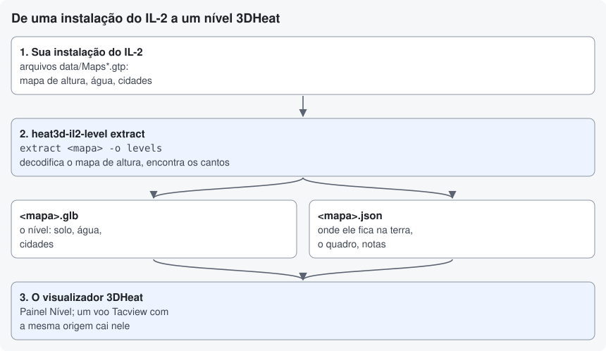

# 3DHeat IL-2 {#dheat-il-2}

**O que é?** Um pequeno programa que transforma os mapas de **IL-2 Sturmovik:
Great Battles**, lidos da **sua própria instalação**, em modelos 3D - níveis -
sobre os quais você pode voar no visualizador [3DHeat](https://github.com/Holdi601/3DHeat)
([documentação](https://holdi601.github.io/3DHeat/)): os morros, rios,
lagos, o mar e as cidades, colocados onde ficam na terra. Um segundo jogo IL-2
cujos arquivos escondem a sua tabela de arquivos é lido até onde eles permitem
([detalhes](archives-without-table.md)).

**Para que eu usaria?** Para ver os seus voos de IL-2 sobre o mapa do próprio jogo.

**Exemplo:** `heat3d-il2-level extract <mapa> -o levels` ->
`levels/<mapa>/<mapa>.glb` (o nível) + `<mapa>.json` (onde ele fica na
terra). Um mapa de altura é uma grade de alturas, como um mapa de relevo; uma gravação Tacview
é um arquivo de um voo que o Tacview grava.

Para que serve:

- **Voos sobre o mapa do próprio jogo.** Uma gravação Tacview do IL-2, convertida pelo
  3DHeat Watcher com a mesma origem, cai no nível sem nenhuma etapa de posicionamento.
- **Todos os mapas de uma vez.** `extract --all` grava cada mapa encontrado; as temporadas que
  compartilham um mapa de altura são gravadas uma vez.
- **Onde fica na terra.** O `.json` de cada nível traz os seus cantos e a sua caixa de
  latitude/longitude, e como foram encontrados.



## Início rápido {#quick-start}

Nunca usou a linha de comando? Leia primeiro [Antes de começar](before-you-start.md).
Execute estes comandos na pasta em que você clonou ou descompactou a ferramenta:

```bash
python -m pip install -e .                         # instala o comando heat3d-il2-level
python -m pip install -e .[fast]                   # com numba: decodificação 20 a 50 vezes mais rápida
heat3d-il2-level list                              # cada mapa encontrado, com a sua caixa de latitude/longitude
heat3d-il2-level extract <mapa> -o levels          # um mapa (nomes como `list` os imprime, curingas permitidos)
heat3d-il2-level extract --all -o levels           # todos os mapas
```

Você deve ver uma linha por mapa em `list`, e `ok ...` em `extract`.
Depois carregue `levels/<mapa>/<mapa>.glb` no painel Fundo / nível do visualizador
([Níveis](https://holdi601.github.io/3DHeat/levels.html)).

Os níveis que ela grava são montados a partir dos dados do jogo: eles ficam na **sua
máquina**; nunca os publique ([Termos](terms.md)).

## Páginas {#pages}

| Página | O que cobre |
|---|---|
| [Antes de começar](before-you-start.md) | Python, um terminal, uma primeira execução |
| [Encontrar mapas: list](list.md) | onde as instalações são encontradas, o que `list` imprime |
| [Montar níveis: extract](extract.md) | cada opção, passo a passo, exemplos |
| [Os arquivos do nível e os quadros](output.md) | as partes `.glb`, o `.json`, os quadros `enu` e `game` |
| [Como os arquivos são lidos](reading.md) | arquivos, o codec do mapa de altura, água, cidades, ajustes por marcos |
| [Arquivos sem tabela de arquivos](archives-without-table.md) | o segundo jogo, lido até onde os seus arquivos permitem |
| [Velocidade, testes, termos](terms.md) | numba, os testes, os termos do jogo, a licença |
| [Referência de comandos](../cli-reference.md) | cada opção, gerada a partir do código |
| [Manutenção destas páginas](maintaining.md) | a lista de verificação de cada versão |

## Relacionados {#related}

- O visualizador 3DHeat: [github.com/Holdi601/3DHeat](https://github.com/Holdi601/3DHeat),
  documentação em [holdi601.github.io/3DHeat](https://holdi601.github.io/3DHeat/).
- Telemetria para estes níveis: o [3DHeat Watcher](https://holdi601.github.io/3DHeat-Watcher/)
  converte gravações Tacview do IL-2; os formatos de arquivo do visualizador, incluindo o seu
  contêiner de uma partida em um só arquivo, são descritos em
  [Um arquivo por partida (.3dheat)](https://holdi601.github.io/3DHeat/container.html).

## As ferramentas 3DHeat {#the-3dheat-tools}

| Ferramenta | O que faz | Código | Documentação |
|---|---|---|---|
| Visualizador 3DHeat | mostra os dados: mapas de calor, análise de corrida, revisão de partidas | [3DHeat](https://github.com/Holdi601/3DHeat) | [docs](https://holdi601.github.io/3DHeat/) |
| GameFiles | níveis e percursos a partir dos arquivos do próprio jogo | [3DHeat-GameFiles](https://github.com/Holdi601/3DHeat-GameFiles) | [docs](https://holdi601.github.io/3DHeat-GameFiles/) |
| GameCapture | telemetria de voltas, e níveis reconstruídos a partir de vídeo de jogo | [3DHeat-GameCapture](https://github.com/Holdi601/3DHeat-GameCapture) | [docs](https://holdi601.github.io/3DHeat-GameCapture/) |
| Unreal Exporter | um plugin do Unreal Editor: um nível como um único `.glb` | [3DHeat-UnrealExporter](https://github.com/Holdi601/3DHeat-UnrealExporter) | [docs](https://holdi601.github.io/3DHeat-UnrealExporter/) |
| CS2 | demos e mapas do Counter-Strike 2 | [3DHeat-CS2](https://github.com/Holdi601/3DHeat-CS2) | [docs](https://holdi601.github.io/3DHeat-CS2/) |
| Watcher | registra o que os jogos publicam enquanto você joga | [3DHeat-Watcher](https://github.com/Holdi601/3DHeat-Watcher) | [docs](https://holdi601.github.io/3DHeat-Watcher/) |
| Ext-WarThunder | repetições do War Thunder | [3DHeat-Ext-WarThunder](https://github.com/Holdi601/3DHeat-Ext-WarThunder) | [docs](https://holdi601.github.io/3DHeat-Ext-WarThunder/) |
| Ext-WoT | repetições do World of Tanks | [3DHeat-Ext-WoT](https://github.com/Holdi601/3DHeat-Ext-WoT) | [docs](https://holdi601.github.io/3DHeat-Ext-WoT/) |
| Ext-WoWs | repetições do World of Warships | [3DHeat-Ext-WoWs](https://github.com/Holdi601/3DHeat-Ext-WoWs) | [docs](https://holdi601.github.io/3DHeat-Ext-WoWs/) |
| Ext-Squad | demos de servidores do Squad | [3DHeat-Ext-Squad](https://github.com/Holdi601/3DHeat-Ext-Squad) | [docs](https://holdi601.github.io/3DHeat-Ext-Squad/) |
| Ext-DCS | mapas do DCS World como níveis 3D | [3DHeat-Ext-DCS](https://github.com/Holdi601/3DHeat-Ext-DCS) | [docs](https://holdi601.github.io/3DHeat-Ext-DCS/) |
| Ext-IL2 | mapas do IL-2 Sturmovik como níveis 3D | [3DHeat-Ext-IL2](https://github.com/Holdi601/3DHeat-Ext-IL2) | [docs](https://holdi601.github.io/3DHeat-Ext-IL2/) |
