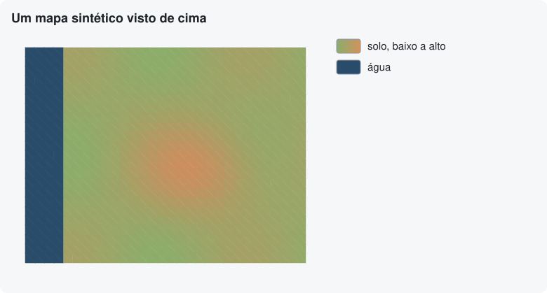

# Os arquivos do nível e os quadros {#the-level-files-and-frames}

`<saída>/<mapa>/<mapa>.glb` (o nível: um modelo 3D do solo) e `<mapa>.json`
ao lado. O glb é gravado em
`<mapa>.glb.part` e renomeado quando fica completo.

| Parte | O que é |
|---|---|
| `ground:<mapa>` | o mapa de altura do terreno como grade, no máximo `--max-grid` amostras por lado (padrão 1024: cerca de 2 milhões de triângulos) |
| `water:<mapa>` | rios, lagos e mar: quadriláteros planos na altura da água, um por célula de grade cujas amostras do mapa de altura estejam suficientemente debaixo d'água (um terço com a máscara de água do mapa, metade sem ela) |
| `ground:<mapa> towns` | as áreas construídas de cidades e vilarejos, apoiadas 1,5 m acima do solo |

O JSON traz os **cantos e a caixa de latitude/longitude** do mapa (`corners`,
`extent`), como foram encontrados (`georeference`), as configurações de altura
(`heightMul`, `SeaLevel`), a área de jogo nos metros do jogo (`playArea`), o quadro
e a sua origem (`frame`, `geo`), as contagens de triângulos e as `notes` (notas).

## Quadros {#frames}

Dois quadros, `--frame`:

- `enu` (padrão): metros a leste, altitude acima do nível do mar, e norte de uma origem no
  plano tangente WGS-84: o mapa plano em que o 3DHeat Watcher coloca uma gravação Tacview do IL-2
  (x leste, y altitude, z norte, desenhado com z espelhado). O glb
  guarda (leste, altitude, -norte). Converta com `--origin <lat> <lon>` com o `geo` de uma
  gravação (o ponto de referência da sua sessão) e a gravação cai no nível sem nenhuma
  etapa de posicionamento; sem isso, o centro do mapa é a origem, e o `geo` do JSON mostra qual.
- `game`: os metros do próprio jogo, como os arquivos de missão os têm: x norte a partir da borda sul,
  y a altura do jogo, z leste a partir da borda oeste (destro como é, então glb = (x, y, z)). Mapas que
  não podem ser colocados sobre a terra são gravados neste quadro seja o que for pedido, com uma nota.

O nível é um binário glTF com partes nomeadas, como todo nível do 3DHeat; a página
[Níveis](https://holdi601.github.io/3DHeat/levels.html) do visualizador diz como ele os carrega.
