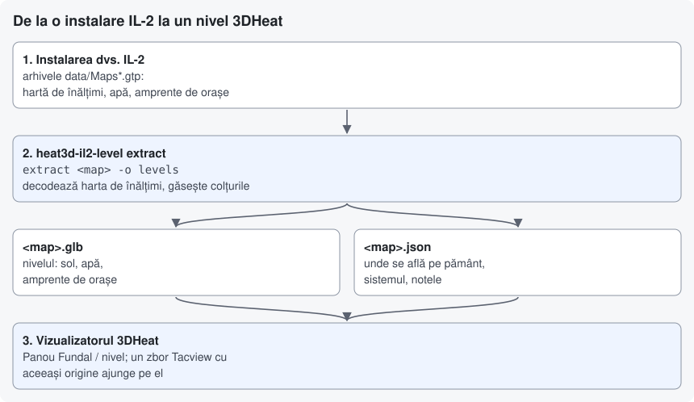

# 3DHeat IL-2 {#dheat-il-2}

**Ce este?** Un program mic care transformă hărțile jocului **IL-2 Sturmovik: Great Battles**, citite din
**instalarea dumneavoastră**, în modele 3D - niveluri - peste care puteți zbura în vizualizatorul
[3DHeat](https://github.com/Holdi601/3DHeat) ([documentație](https://holdi601.github.io/3DHeat/)): dealurile, râurile,
lacurile, marea și orașele, așezate acolo unde se află pe pământ. Un al doilea joc IL-2, ale cărui arhive
ascund tabelul de fișiere, se citește cât permit arhivele ([detalii](archives-without-table.md)).

**De ce l-aș folosi?** Ca să vedeți zborurile dumneavoastră IL-2 peste harta proprie a jocului.

**Exemplu:** `heat3d-il2-level extract <map> -o levels` ->
`levels/<map>/<map>.glb` (nivelul) + `<map>.json` (unde se află pe pământ). O hartă de înălțimi este o
grilă de înălțimi, ca o hartă în relief; o înregistrare Tacview este un fișier cu un zbor, scris de Tacview.

La ce este util:

- **Zboruri pe harta proprie a jocului.** O înregistrare Tacview IL-2, convertită de 3DHeat Watcher cu
  aceeași origine, ajunge pe nivel fără niciun pas de plasare.
- **Fiecare hartă deodată.** `extract --all` scrie fiecare hartă găsită; sezoanele care au aceeași hartă
  de înălțimi se scriu o singură dată.
- **Unde se află pe pământ.** Fiecare `.json` de nivel poartă colțurile și caseta latitudine/longitudine,
  și cum au fost găsite.



## Pornire rapidă {#quick-start}

Nu ați mai lucrat în linia de comandă? Citiți mai întâi [Înainte de a începe](before-you-start.md).
Rulați acestea în dosarul în care ați clonat sau dezarhivat instrumentul:

```bash
python -m pip install -e .                         # installs the heat3d-il2-level command
python -m pip install -e .[fast]                            # with numba: decoding 20 to 50 times faster
heat3d-il2-level list                              # every map found, with its latitude/longitude box
heat3d-il2-level extract <map> -o levels           # one map (names as `list` prints them, wildcards allowed)
heat3d-il2-level extract --all -o levels           # every map
```

Ar trebui să vedeți câte o linie pentru fiecare hartă din `list` și `ok ...` din `extract`.
Apoi încărcați `levels/<map>/<map>.glb` în panoul Fundal / nivel al vizualizatorului
([Niveluri](https://holdi601.github.io/3DHeat/levels.html)).

Nivelurile pe care le scrie sunt construite din datele jocului: ele rămân **pe calculatorul
dumneavoastră**; nu le publicați niciodată ([Condiții](terms.md)).

## Pagini {#pages}

| Pagina | Ce acoperă |
|---|---|
| [Înainte de a începe](before-you-start.md) | Python, un terminal, o primă rulare |
| [Găsirea hărților: list](list.md) | unde se găsesc instalările, ce afișează `list` |
| [Construirea nivelurilor: extract](extract.md) | fiecare opțiune, pas cu pas, exemple |
| [Fișierele nivelului și sistemele de coordonate](output.md) | părțile `.glb`, `.json`, sistemele `enu` și `game` |
| [Cum se citesc fișierele](reading.md) | arhive, codecul hărții de înălțimi, apa, orașele, potrivirile după repere |
| [Arhive fără tabel de fișiere](archives-without-table.md) | al doilea joc, citit cât permit arhivele sale |
| [Viteză, teste, condiții](terms.md) | numba, testele, condițiile jocului, licența |
| [Referința comenzilor](../cli-reference.md) | fiecare opțiune, generată din cod |
| [Întreținerea acestor documente](maintaining.md) | lista de verificare pentru lansare |

## Legături {#related}

- Vizualizatorul 3DHeat: [github.com/Holdi601/3DHeat](https://github.com/Holdi601/3DHeat),
  documentația la [holdi601.github.io/3DHeat](https://holdi601.github.io/3DHeat/).
- Telemetria pentru aceste niveluri: [3DHeat Watcher](https://holdi601.github.io/3DHeat-Watcher/)
  convertește înregistrările Tacview IL-2; formatele de fișiere ale vizualizatorului, inclusiv containerul
  său cu un fișier pe meci, sunt descrise în [Un fișier pe meci (.3dheat)](https://holdi601.github.io/3DHeat/container.html).

## Instrumentele 3DHeat {#the-3dheat-tools}

| Instrument | Ce face | Cod | Documentație |
|---|---|---|---|
| Vizualizatorul 3DHeat | arată datele: hărți termice, analiza cursei, revizuirea meciului | [3DHeat](https://github.com/Holdi601/3DHeat) | [documentație](https://holdi601.github.io/3DHeat/) |
| GameFiles | niveluri și trasee din fișierele proprii ale unui joc | [3DHeat-GameFiles](https://github.com/Holdi601/3DHeat-GameFiles) | [documentație](https://holdi601.github.io/3DHeat-GameFiles/) |
| GameCapture | telemetria turelor și niveluri reconstruite din videoclipuri de joc | [3DHeat-GameCapture](https://github.com/Holdi601/3DHeat-GameCapture) | [documentație](https://holdi601.github.io/3DHeat-GameCapture/) |
| Unreal Exporter | un plugin pentru Unreal Editor: un nivel ca un singur `.glb` | [3DHeat-UnrealExporter](https://github.com/Holdi601/3DHeat-UnrealExporter) | [documentație](https://holdi601.github.io/3DHeat-UnrealExporter/) |
| CS2 | demo-uri și hărți Counter-Strike 2 | [3DHeat-CS2](https://github.com/Holdi601/3DHeat-CS2) | [documentație](https://holdi601.github.io/3DHeat-CS2/) |
| Watcher | înregistrează ce publică jocurile cât jucați | [3DHeat-Watcher](https://github.com/Holdi601/3DHeat-Watcher) | [documentație](https://holdi601.github.io/3DHeat-Watcher/) |
| Ext-WarThunder | replay-uri War Thunder | [3DHeat-Ext-WarThunder](https://github.com/Holdi601/3DHeat-Ext-WarThunder) | [documentație](https://holdi601.github.io/3DHeat-Ext-WarThunder/) |
| Ext-WoT | replay-uri World of Tanks | [3DHeat-Ext-WoT](https://github.com/Holdi601/3DHeat-Ext-WoT) | [documentație](https://holdi601.github.io/3DHeat-Ext-WoT/) |
| Ext-WoWs | replay-uri World of Warships | [3DHeat-Ext-WoWs](https://github.com/Holdi601/3DHeat-Ext-WoWs) | [documentație](https://holdi601.github.io/3DHeat-Ext-WoWs/) |
| Ext-Squad | demo-uri de server Squad | [3DHeat-Ext-Squad](https://github.com/Holdi601/3DHeat-Ext-Squad) | [documentație](https://holdi601.github.io/3DHeat-Ext-Squad/) |
| Ext-DCS | hărțile DCS World ca niveluri 3D | [3DHeat-Ext-DCS](https://github.com/Holdi601/3DHeat-Ext-DCS) | [documentație](https://holdi601.github.io/3DHeat-Ext-DCS/) |
| Ext-IL2 | hărțile IL-2 Sturmovik ca niveluri 3D | [3DHeat-Ext-IL2](https://github.com/Holdi601/3DHeat-Ext-IL2) | [documentație](https://holdi601.github.io/3DHeat-Ext-IL2/) |
