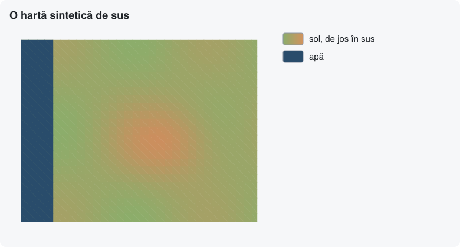

# Fișierele nivelului și sistemele de coordonate {#the-level-files-and-frames}

`<out>/<map>/<map>.glb` (nivelul: un model 3D al solului) și `<map>.json` alături.
Fișierul glb se scrie în `<map>.glb.part` și se redenumește când este complet.

| Parte | Ce este |
|---|---|
| `ground:<map>` | harta de înălțimi a terenului, ca o grilă, cu cel mult `--max-grid` eșantioane pe o latură (implicit 1024: circa 2 milioane de triunghiuri) |
| `water:<map>` | râuri, lacuri și mare: pătrate plate la înălțimea apei, câte unul pentru fiecare celulă a grilei din care suficiente eșantioane ale hărții de înălțimi sunt sub apă (o treime cu harta de apă a hărții, jumătate fără ea) |
| `ground:<map> towns` | amprentele construite ale orașelor și satelor, lăsate cu 1,5 m peste sol |

JSON-ul conține **colțurile și caseta latitudine/longitudine** ale hărții (`corners`,
`extent`), cum au fost găsite (`georeference`), setările de înălțime (`heightMul`, `SeaLevel`), zona
de joc în metrii jocului (`playArea`), sistemul de coordonate și originea sa (`frame`, `geo`),
numărul de triunghiuri și orice `notes`.

## Sisteme de coordonate {#frames}

Două sisteme, `--frame`:

- `enu` (implicit): metri est, altitudine deasupra nivelului mării, nord față de o origine pe planul
  tangent WGS-84: harta plată în care 3DHeat Watcher pune o înregistrare Tacview IL-2 (x est, y altitudine,
  z nord, desenată cu z oglindit). Glb stochează (est, altitudine, -nord). Convertiți cu `--origin <lat> <lon>`
  egal cu `geo` al unei înregistrări (punctul de referință al sesiunii sale) și înregistrarea ajunge pe nivel
  fără pas de plasare; fără el, centrul hărții este originea, iar `geo` din JSON spune care este.
- `game`: metrii proprii ai jocului, așa cum îi au fișierele de misiune: x nord de la marginea de sud,
  y înălțimea jocului, z est de la marginea de vest (drept-orientat, așa cum este, deci glb = (x, y, z)).
  Hărțile care nu pot fi plasate pe pământ sunt scrise în acest sistem, oricare ar fi cererea, cu o notă.

Nivelul este un binar glTF cu părți numite, ca orice nivel 3DHeat; pagina
[Niveluri](https://holdi601.github.io/3DHeat/levels.html) a vizualizatorului spune cum le încarcă.
