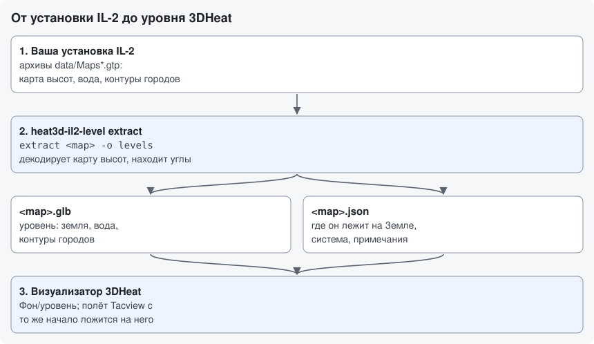

# 3DHeat IL-2 {#dheat-il-2}

**Что это?** Небольшая программа, которая превращает карты **IL-2 Sturmovik: Great Battles**,
прочитанные из **вашей собственной установки**, в 3D-модели — уровни, над которыми можно лететь в
просмотрщике [3DHeat](https://github.com/Holdi601/3DHeat)
([документация](https://holdi601.github.io/3DHeat/)): холмы, реки, озёра, море и города, положенные
туда, где они лежат на Земле. Вторая игра IL-2, у которой архивы скрывают таблицу файлов, читается
настолько, насколько позволяют её архивы ([подробнее](archives-without-table.md)).

**Зачем это нужно?** Чтобы видеть свои полёты в IL-2 на собственной карте игры.

**Пример:** `heat3d-il2-level extract <map> -o levels` ->
`levels/<map>/<map>.glb` (уровень) + `<map>.json` (где он лежит на Земле). Карта высот — это
сетка высот, как рельефная карта; запись Tacview — это файл полёта, который пишет Tacview.

Для чего это полезно:

- **Полёты на карте игры.** Запись IL-2 из Tacview, преобразованная 3DHeat Watcher с тем же
  началом, ложится на уровень без шага размещения.
- **Все карты сразу.** `extract --all` записывает каждую найденную карту; сезоны, у которых общая
  карта высот, записываются один раз.
- **Где на Земле.** Каждый `.json` уровня несёт свои углы и прямоугольник широты/долготы, а также то,
  как они были найдены.



## Быстрый старт {#quick-start}

Впервые в командной строке? Сначала прочитайте [С чего начать](before-you-start.md).
Выполняйте эти команды в папке, которую вы клонировали или распаковали:

```bash
python -m pip install -e .                         # устанавливает команду heat3d-il2-level
python -m pip install -e .[fast]                            # с numba: декодирование в 20–50 раз быстрее
heat3d-il2-level list                              # каждая найденная карта с её прямоугольником широты/долготы
heat3d-il2-level extract <map> -o levels           # одна карта (имена, как их выводит `list`, допускаются подстановочные знаки)
heat3d-il2-level extract --all -o levels           # каждая карта
```

Вы увидите строку на карту из `list` и `ok ...` из `extract`.
Затем загрузите `levels/<map>/<map>.glb` в панель «Фон / уровень» просмотрщика
([Уровни](https://holdi601.github.io/3DHeat/levels.html)).

Уровни, которые она пишет, построены по данным игры: они остаются **на вашем компьютере**;
никогда не публикуйте их ([Условия](terms.md)).

## Страницы {#pages}

| Страница | Что в ней |
|---|---|
| [С чего начать](before-you-start.md) | Python, терминал, первый запуск |
| [Поиск карт: list](list.md) | где находятся установки, что выводит `list` |
| [Построение уровней: extract](extract.md) | каждый параметр, пошагово, примеры |
| [Файлы уровней и системы координат](output.md) | части `.glb`, `.json`, системы `enu` и `game` |
| [Как читаются файлы](reading.md) | архивы, кодек карты высот, вода, города, подгонка по ориентирам |
| [Архивы без таблицы файлов](archives-without-table.md) | вторая игра, прочитанная настолько, насколько позволяют её архивы |
| [Скорость, тесты, условия](terms.md) | numba, тесты, условия игры, лицензия |
| [Справка по командам](../cli-reference.md) | каждый параметр, создано из кода |
| [Сопровождение документации](maintaining.md) | контрольный список выпуска |

## Связанное {#related}

- Просмотрщик 3DHeat: [github.com/Holdi601/3DHeat](https://github.com/Holdi601/3DHeat),
  документация на [holdi601.github.io/3DHeat](https://holdi601.github.io/3DHeat/).
- Телеметрия для этих уровней: [3DHeat Watcher](https://holdi601.github.io/3DHeat-Watcher/)
  преобразует записи Tacview для IL-2; форматы файлов просмотрщика, включая контейнер
  «один файл на матч», описаны на странице
  [Один файл на матч (.3dheat)](https://holdi601.github.io/3DHeat/container.html).

## Инструменты 3DHeat {#the-3dheat-tools}

| Инструмент | Что делает | Код | Документация |
|---|---|---|---|
| Просмотрщик 3DHeat | показывает данные: тепловые карты, анализ заездов, разбор матчей | [3DHeat](https://github.com/Holdi601/3DHeat) | [docs](https://holdi601.github.io/3DHeat/) |
| GameFiles | уровни и трассы из собственных файлов игры | [3DHeat-GameFiles](https://github.com/Holdi601/3DHeat-GameFiles) | [docs](https://holdi601.github.io/3DHeat-GameFiles/) |
| GameCapture | телеметрия кругов и уровни, восстановленные по видео игры | [3DHeat-GameCapture](https://github.com/Holdi601/3DHeat-GameCapture) | [docs](https://holdi601.github.io/3DHeat-GameCapture/) |
| Unreal Exporter | плагин редактора Unreal: уровень одним `.glb` | [3DHeat-UnrealExporter](https://github.com/Holdi601/3DHeat-UnrealExporter) | [docs](https://holdi601.github.io/3DHeat-UnrealExporter/) |
| CS2 | демо и карты Counter-Strike 2 | [3DHeat-CS2](https://github.com/Holdi601/3DHeat-CS2) | [docs](https://holdi601.github.io/3DHeat-CS2/) |
| Watcher | записывает то, что игры публикуют во время игры | [3DHeat-Watcher](https://github.com/Holdi601/3DHeat-Watcher) | [docs](https://holdi601.github.io/3DHeat-Watcher/) |
| Ext-WarThunder | реплеи War Thunder | [3DHeat-Ext-WarThunder](https://github.com/Holdi601/3DHeat-Ext-WarThunder) | [docs](https://holdi601.github.io/3DHeat-Ext-WarThunder/) |
| Ext-WoT | реплеи World of Tanks | [3DHeat-Ext-WoT](https://github.com/Holdi601/3DHeat-Ext-WoT) | [docs](https://holdi601.github.io/3DHeat-Ext-WoT/) |
| Ext-WoWs | реплеи World of Warships | [3DHeat-Ext-WoWs](https://github.com/Holdi601/3DHeat-Ext-WoWs) | [docs](https://holdi601.github.io/3DHeat-Ext-WoWs/) |
| Ext-Squad | демо серверов Squad | [3DHeat-Ext-Squad](https://github.com/Holdi601/3DHeat-Ext-Squad) | [docs](https://holdi601.github.io/3DHeat-Ext-Squad/) |
| Ext-DCS | карты DCS World как 3D-уровни | [3DHeat-Ext-DCS](https://github.com/Holdi601/3DHeat-Ext-DCS) | [docs](https://holdi601.github.io/3DHeat-Ext-DCS/) |
| Ext-IL2 | карты IL-2 Sturmovik как 3D-уровни | [3DHeat-Ext-IL2](https://github.com/Holdi601/3DHeat-Ext-IL2) | [docs](https://holdi601.github.io/3DHeat-Ext-IL2/) |
