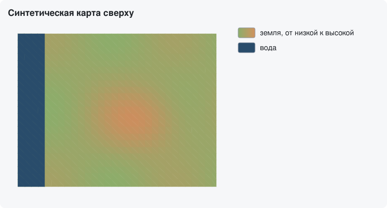

# Файлы уровней и системы координат {#the-level-files-and-frames}

`<out>/<map>/<map>.glb` (уровень: 3D-модель земли) и `<map>.json` рядом с ним. Файл glb пишется в
`<map>.glb.part` и переименовывается, когда готов.

| Часть | Что это |
|---|---|
| `ground:<map>` | карта высот местности как сетка, не больше `--max-grid` отсчётов по стороне (по умолчанию 1024: около 2 миллионов треугольников) |
| `water:<map>` | реки, озёра и море: плоские четырёхугольники на высоте воды, по одному на ячейку сетки, если под водой достаточно отсчётов карты высот (треть с маской воды карты, половина без неё) |
| `ground:<map> towns` | застроенные контуры городов и деревень, наложенные на 1,5 м поверх земли |

В JSON записаны **углы карты и прямоугольник широты/долготы** (`corners`, `extent`), то, как их
нашли (`georeference`), настройки высоты (`heightMul`, `SeaLevel`), игровая зона в метрах игры
(`playArea`), система и её начало (`frame`, `geo`), число треугольников и любые `notes`.

## Системы координат {#frames}

Две системы, `--frame`:

- `enu` (по умолчанию): метры на восток, высота над уровнем моря, метры на север от начала на
  касательной плоскости WGS-84: плоская карта, в которую Watcher 3DHeat помещает запись Tacview для IL-2
  (x — восток, y — высота, z — север, рисуется с отражённым z). glb хранит (восток, высота, -север).
  Переведите, указав `--origin <lat> <lon>`, равное `geo` записи (опорной точке её сессии), и запись
  ляжет на уровень без шага размещения; без этого центр карты становится началом, а `geo` в JSON
  показывает, какой именно.
- `game`: собственные метры игры, как их держат файлы миссий: x — север от южного края, y — высота
  игры, z — восток от западного края (правосторонняя система, как есть, так что glb = (x, y, z)).
  Карты, которые нельзя разместить на Земле, пишутся в этой системе, что бы ни было запрошено, с
  примечанием.

Уровень — это двоичный glTF с именованными частями, как и любой уровень 3DHeat; страница
просмотрщика [Уровни](https://holdi601.github.io/3DHeat/levels.html) рассказывает, как он их загружает.
