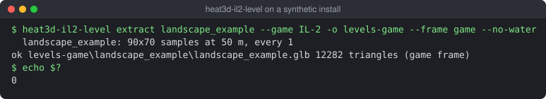

# Vytváranie úrovní: `extract` {#building-levels-extract}

```text
heat3d-il2-level extract (<map> ... | --all) -o <folder> [--game FOLDER ...]
                 [--max-grid N] [--frame enu|game] [--origin LAT LON]
                 [--no-water] [--no-towns] [--skip-existing]
```

## Krok za krokom {#step-by-step}

Nikdy ste nepracovali s príkazovým riadkom? Najprv si prečítajte [Ako začať](before-you-start.md).

1. Názov mapy zistite príkazom [`list`](list.md).
2. Spustite `heat3d-il2-level extract <map> -o levels`. Názvy môžu obsahovať zástupné znaky
   v úvodzovkách (`"<family>_*"`); `--all` vezme každú mapu.
3. Ak chcete nahrávku dať na úroveň bez kroku umiestňovania, zadajte jej začiatok:
   `--origin <lat> <lon>` nastavený na `geo` nahrávky (referenčný bod jej session). Bez neho je začiatkom stred mapy a `geo` v `.json` ukazuje, ktorý.
4. Príkaz vypisuje riadok na každú mapu pri jej dekódovaní, potom
   `ok <glb> <triangles> (<frame> frame)` alebo `failed <map>: <why>`.
5. Načítajte `<folder>/<map>/<map>.glb` do panela Pozadie / level prehliadača.


V metroch samotnej hry, bez vody:



Ďalší beh nad mapami, ktoré už sú zapísané:


## Možnosti {#options}

| Možnosť | Predvolené | Čo robí |
|---|---|---|
| `maps` | - | názvy máp tak, ako ich vypisuje `list`; zástupné znaky sú povolené |
| `--all` | vypnuté | každá mapa; ročné obdobia, ktoré zdieľajú výškovú mapu a mapu vody, sa zapíšu raz |
| `-o`, `--out` | povinné | výstupný priečinok; každá mapa ide do `<out>/<map>/` |
| `--game FOLDER` | nájdené | priečinok IL-2 (možno opakovať) |
| `--max-grid N` | `1024` | najviac toľko vzoriek výškovej mapy na jednu stranu (1024: asi 2 milióny trojuholníkov); mapa sa vzorkuje každých *k* vzoriek, aby sa zmestila |
| `--frame` `enu` alebo `game` | `enu` | `enu`: metre na východ, nadmorská výška, na sever od `--origin`, ako tabuľky Tacview od Watchera; `game`: vlastné metre hry (x na sever, y hore, z na východ). Mapa, ktorú nemožno umiestniť na zem, sa zapíše v `game` bez ohľadu na to, čo ste zadali |
| `--origin LAT LON` | stred mapy | začiatok rámca `enu` (`geo` nahrávky) |
| `--no-water` | vypnuté | vodu vynechá |
| `--no-towns` | vypnuté | vynechá stopy miest |
| `--skip-existing` | vypnuté | nechá mapy, ktorých `.glb` už existuje |

Každá možnosť tak, ako ju program vypisuje: [Referencia príkazov](../cli-reference.md).

Nastavte `HEAT3D_DEBUG`, aby sa vypísal úplný výpis chyby pri zlyhanej mape. Súbor `.glb` sa zapisuje do
`<map>.glb.part` a po dokončení sa premenuje.

Stavový kód: 0 každá mapa zapísaná; 1 ktorákoľvek zlyhala (ostatné sa aj tak zapíšu); 2 nenájdená inštalácia alebo žiadna mapa nevyhovela.

## Príklady {#examples}

```bash
heat3d-il2-level extract <map> -o levels                         # jedna mapa, rámec enu okolo jej stredu
heat3d-il2-level extract <map> --origin <lat> <lon> -o levels    # na ploché mape nahrávky s týmto geo
heat3d-il2-level extract "<family>_*" --max-grid 2048 -o levels  # jemnejšie, viac máp
heat3d-il2-level extract --all --skip-existing -o levels         # každá mapa, len nové
heat3d-il2-level extract <map> --frame game -o levels            # vlastné metre hry, tak ako ich majú súbory misií
```

Čo je v súboroch: [Súbory úrovne a rámce](output.md).
