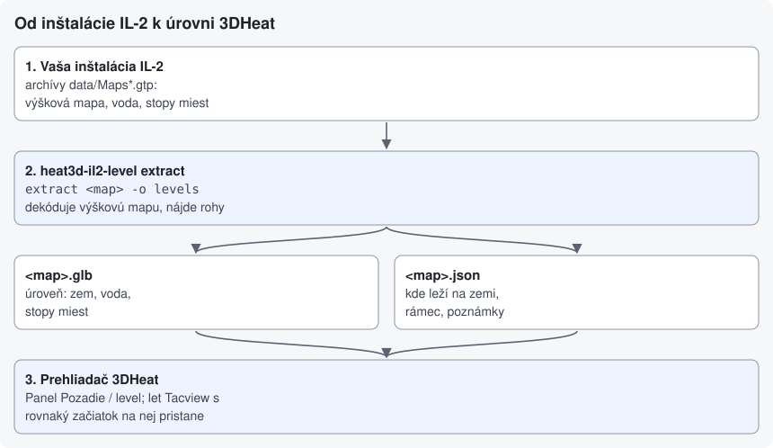

# 3DHeat IL-2 {#dheat-il-2}

**Čo to je?** Malý program, ktorý mení mapy hry **IL-2 Sturmovik:
Great Battles**, načítané z **vašej vlastnej inštalácie**, na 3D modely – úrovne –
nad ktorými môžete lietať v prehliadači [3DHeat](https://github.com/Holdi601/3DHeat)
([dokumentácia](https://holdi601.github.io/3DHeat/)): kopce, rieky,
jazerá, more a mestá, umiestnené tam, kde ležia na zemi. Druhá hra IL-2, ktorej archívy skrývajú
tabuľku súborov, sa číta tak ďaleko, ako to archívy dovoľujú
([podrobnosti](archives-without-table.md)).

**Prečo by som ho použil?** Aby ste videli svoje lety v IL-2 nad vlastnou mapou hry.

**Príklad:** `heat3d-il2-level extract <map> -o levels` ->
`levels/<map>/<map>.glb` (úroveň) + `<map>.json` (kde leží na
zemi). Výšková mapa je mriežka výšok, ako reliéfna mapa; záznam Tacview je súbor letu, ktorý zapisuje Tacview.

Na čo je to užitočné:

- **Lety na vlastnej mape hry.** Záznam IL-2 Tacview, prevedený nástrojom 3DHeat Watcher s rovnakým začiatkom, pristane na úrovni bez kroku umiestňovania.
- **Každá mapa naraz.** `extract --all` zapíše každú nájdenú mapu; ročné obdobia, ktoré zdieľajú výškovú mapu, sa zapíšu raz.
- **Kde na zemi.** `.json` každej úrovne nesie jej rohy a ohraničujúci box zemepisnej šírky a dĺžky a to, ako sa našli.



## Rýchly štart {#quick-start}

Nikdy ste nepracovali s príkazovým riadkom? Najprv si prečítajte [Ako začať](before-you-start.md).
Spustite tieto príkazy v priečinku, do ktorého ste nainštalovali alebo rozbalili nástroj:

```bash
python -m pip install -e .                         # nainštaluje príkaz heat3d-il2-level
python -m pip install -e .[fast]                            # s numba: dekódovanie 20- až 50-krát rýchlejšie
heat3d-il2-level list                              # každá nájdená mapa s jej ohraničujúcim boxom zemepisnej šírky a dĺžky
heat3d-il2-level extract <map> -o levels           # jedna mapa (názvy tak, ako ich vypisuje `list`, zástupné znaky sú povolené)
heat3d-il2-level extract --all -o levels           # každá mapa
```

Z `list` uvidíte riadok na mapu a z `extract` riadok `ok ...`.
Potom načítajte `levels/<map>/<map>.glb` do panela Pozadie / level prehliadača
([Úrovne](https://holdi601.github.io/3DHeat/levels.html)).

Úrovne, ktoré zapisuje, sú postavené z dát hry: ostávajú **na vašom
počítači**; nikdy ich nezverejňujte ([Podmienky](terms.md)).

## Stránky {#pages}

| Stránka | Čo obsahuje |
|---|---|
| [Ako začať](before-you-start.md) | Python, terminál, prvé spustenie |
| [Hľadanie máp: list](list.md) | kde sa nájdu inštalácie, čo vypisuje `list` |
| [Vytváranie úrovní: extract](extract.md) | každá možnosť, krok za krokom, príklady |
| [Súbory úrovne a rámce](output.md) | časti `.glb`, `.json`, rámce `enu` a `game` |
| [Ako sa čítajú súbory](reading.md) | archívy, kodek výškovej mapy, voda, mestá, prispôsobenie orientačným bodom |
| [Archívy bez tabuľky súborov](archives-without-table.md) | druhá hra, čítaná tak ďaleko, ako dovolia jej archívy |
| [Rýchlosť, testy, podmienky](terms.md) | numba, testy, podmienky hry, licencia |
| [Referencia príkazov](../cli-reference.md) | každá možnosť, generované z kódu |
| [Údržba týchto dokumentov](maintaining.md) | kontrolný zoznam pri vydaní |

## Súvisiace {#related}

- Prehliadač 3DHeat: [github.com/Holdi601/3DHeat](https://github.com/Holdi601/3DHeat),
  dokumentácia na [holdi601.github.io/3DHeat](https://holdi601.github.io/3DHeat/).
- Telemetria pre tieto úrovne: [3DHeat Watcher](https://holdi601.github.io/3DHeat-Watcher/)
  prevádza záznamy IL-2 Tacview; formáty súborov prehliadača, vrátane jeho kontajnera jeden súbor na zápas,
  sú opísané v [Jeden súbor na zápas (.3dheat)](https://holdi601.github.io/3DHeat/container.html).

## Nástroje 3DHeat {#the-3dheat-tools}

| Nástroj | Čo robí | Kód | Dokumentácia |
|---|---|---|---|
| prehliadač 3DHeat | zobrazuje dáta: heatmapy, analýzu pretekov, prehľad zápasu | [3DHeat](https://github.com/Holdi601/3DHeat) | [dokumentácia](https://holdi601.github.io/3DHeat/) |
| GameFiles | úrovne a trate zo súborov samotnej hry | [3DHeat-GameFiles](https://github.com/Holdi601/3DHeat-GameFiles) | [dokumentácia](https://holdi601.github.io/3DHeat-GameFiles/) |
| GameCapture | telemetria kôl a úrovne zrekonštruované z videa hry | [3DHeat-GameCapture](https://github.com/Holdi601/3DHeat-GameCapture) | [dokumentácia](https://holdi601.github.io/3DHeat-GameCapture/) |
| Unreal Exporter | plugin pre Unreal Editor: úroveň ako jeden `.glb` | [3DHeat-UnrealExporter](https://github.com/Holdi601/3DHeat-UnrealExporter) | [dokumentácia](https://holdi601.github.io/3DHeat-UnrealExporter/) |
| CS2 | dema a mapy Counter-Strike 2 | [3DHeat-CS2](https://github.com/Holdi601/3DHeat-CS2) | [dokumentácia](https://holdi601.github.io/3DHeat-CS2/) |
| Watcher | zaznamenáva, čo hry zverejňujú, kým hráte | [3DHeat-Watcher](https://github.com/Holdi601/3DHeat-Watcher) | [dokumentácia](https://holdi601.github.io/3DHeat-Watcher/) |
| Ext-WarThunder | replaye War Thunder | [3DHeat-Ext-WarThunder](https://github.com/Holdi601/3DHeat-Ext-WarThunder) | [dokumentácia](https://holdi601.github.io/3DHeat-Ext-WarThunder/) |
| Ext-WoT | replaye World of Tanks | [3DHeat-Ext-WoT](https://github.com/Holdi601/3DHeat-Ext-WoT) | [dokumentácia](https://holdi601.github.io/3DHeat-Ext-WoT/) |
| Ext-WoWs | replaye World of Warships | [3DHeat-Ext-WoWs](https://github.com/Holdi601/3DHeat-Ext-WoWs) | [dokumentácia](https://holdi601.github.io/3DHeat-Ext-WoWs/) |
| Ext-Squad | dema zo serverov Squad | [3DHeat-Ext-Squad](https://github.com/Holdi601/3DHeat-Ext-Squad) | [dokumentácia](https://holdi601.github.io/3DHeat-Ext-Squad/) |
| Ext-DCS | mapy DCS World ako 3D úrovne | [3DHeat-Ext-DCS](https://github.com/Holdi601/3DHeat-Ext-DCS) | [dokumentácia](https://holdi601.github.io/3DHeat-Ext-DCS/) |
| Ext-IL2 | mapy IL-2 Sturmovik ako 3D úrovne | [3DHeat-Ext-IL2](https://github.com/Holdi601/3DHeat-Ext-IL2) | [dokumentácia](https://holdi601.github.io/3DHeat-Ext-IL2/) |
