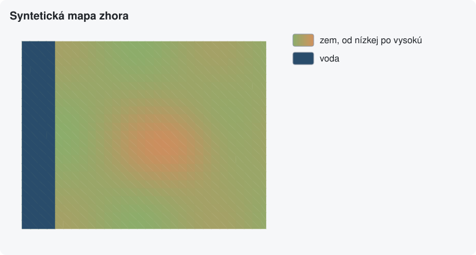

# Súbory úrovne a rámce {#the-level-files-and-frames}

`<out>/<map>/<map>.glb` (úroveň: 3D model zeme) a vedľa neho `<map>.json`.
Súbor glb sa zapisuje do `<map>.glb.part` a po dokončení sa premenuje.

| Časť | Čo to je |
|---|---|
| `ground:<map>` | výšková mapa terénu ako mriežka, najviac `--max-grid` vzoriek na jednu stranu (predvolene 1024: asi 2 milióny trojuholníkov) |
| `water:<map>` | rieky, jazerá a more: ploché štvorce vo výške vody, jeden na každú bunku mriežky, ak je dostatok jej vzoriek výškovej mapy pod vodou (tretina s maskou vody mapy, polovica bez nej) |
| `ground:<map> towns` | zastavané stopy miest a dedín, prevesené 1,5 m nad zemou |

JSON obsahuje **rohy mapy a box zemepisnej šírky a dĺžky** (`corners`,
`extent`), ako sa našli (`georeference`), nastavenia výšky
(`heightMul`, `SeaLevel`), hraciu oblasť vo vlastných metroch hry (`playArea`), rámec a jeho začiatok (`frame`, `geo`), počty trojuholníkov a prípadné `notes`.

## Rámce {#frames}

Dva rámce, `--frame`:

- `enu` (predvolený): metre na východ, nadmorská výška nad morom, na sever od začiatku na
  dotykovej rovine WGS-84: ploché mapy, do ktorej nástroj 3DHeat Watcher kladie záznam IL-2 Tacview
  (x na východ, y nadmorská výška, z na sever, kreslené so zrkadleným z). Glb
  ukladá (východ, nadmorská výška, -sever). Prevediete ho pomocou `--origin <lat> <lon>` nastaveného na `geo` nahrávky (referenčný bod jej session), a nahrávka pristane na úrovni bez kroku umiestňovania; bez neho je začiatkom stred mapy a `geo` v JSON ukazuje, ktorý.
- `game`: vlastné metre hry, tak ako ich majú súbory misií: x na sever od južného okraja, y výška hry, z na východ od západného okraja (pravotočivé tak, ako je, takže glb = (x, y, z)). Mapy, ktoré sa nedajú umiestniť na zem, sa zapisujú v tomto rámci bez ohľadu na to, čo ste zadali, s poznámkou.

Úroveň je binárny glTF s pomenovanými časťami, ako každá úroveň 3DHeat; stránka prehliadača
[Úrovne](https://holdi601.github.io/3DHeat/levels.html) hovorí, ako ich načítava.
