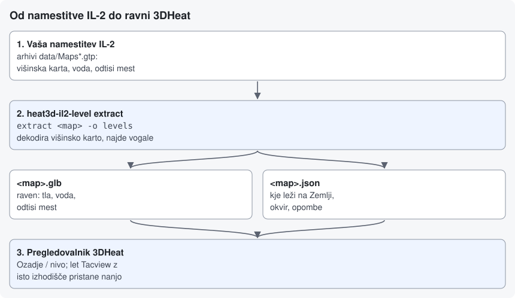

# 3DHeat IL-2 {#dheat-il-2}

**Kaj je to?** Majhen program, ki zemljevide igre **IL-2 Sturmovik: Great Battles**, prebrane iz
**tvoje lastne namestitve**, spremeni v 3D modele - ravni - nad katerimi lahko letiš, v pregledovalniku
[3DHeat](https://github.com/Holdi601/3DHeat) ([dokumentacija](https://holdi601.github.io/3DHeat/)):
griči, reke, jezera, morje in mesta, postavljena tja, kjer ležijo na Zemlji. Druga igra IL-2, katere arhivi
skrivajo svojo tabelo datotek, se prebere do tiste meje, ki jo arhivi dopuščajo
([podrobnosti](archives-without-table.md)).

**Zakaj bi ga uporabil?** Da svoje lete IL-2 vidiš nad igrinim lastnim zemljevidom.

**Primer:** `heat3d-il2-level extract <zemljevid> -o levels` ->
`levels/<zemljevid>/<zemljevid>.glb` (raven) + `<zemljevid>.json` (kje leži na Zemlji). Višinska karta
je mreža višin, kot zemljevid reliefa; posnetek Tacview je datoteka leta, ki jo zapiše Tacview.

Uporabno za:

- **Leti na igrinem lastnem zemljevidu.** Posnetek IL-2 Tacview, ki ga 3DHeat Watcher pretvori z istim
  izhodiščem, pristane na ravni brez koraka postavljanja.
- **Vsi zemljevidi naenkrat.** `extract --all` zapiše vsak najdeni zemljevid; letni časi, ki delijo isto
  višinsko karto, se zapišejo enkrat.
- **Kje na Zemlji.** Vsaka `.json` raven nosi svoje vogale in škatlo zemljepisne širine in dolžine ter
  način, kako so bili najdeni.



## Hitri začetek {#quick-start}

Še nisi vajen ukazne vrstice? Najprej preberi [Preden začneš](before-you-start.md).
Zaženi to v mapi, v katero si kloniral ali razpakiral datoteke:

```bash
python -m pip install -e .                         # namesti ukaz heat3d-il2-level
python -m pip install -e .[fast]                            # z numba: dekodiranje 20- do 50-krat hitreje
heat3d-il2-level list                              # vsak najdeni zemljevid s škatlo zemljepisne širine in dolžine
heat3d-il2-level extract <zemljevid> -o levels     # en zemljevid (imena, kot jih izpiše `list`, dovoljeni so nadomestni znaki)
heat3d-il2-level extract --all -o levels           # vsi zemljevidi
```

Iz `list` bi moral videti vrstico na zemljevid, iz `extract` pa `ok ...`.
Nato naloži `levels/<zemljevid>/<zemljevid>.glb` na plošči Ozadje / nivo pregledovalnika
([Ravni](https://holdi601.github.io/3DHeat/levels.html)).

Ravni, ki jih zapiše, so zgrajene iz igrinih podatkov in ostanejo **na tvojem računalniku**; nikoli jih
ne objavljaj ([Pogoji](terms.md)).

## Strani {#pages}

| Stran | Kaj obravnava |
|---|---|
| [Preden začneš](before-you-start.md) | Python, terminal, prvi zagon |
| [Iskanje zemljevidov: list](list.md) | kje so namestitve najdene, kaj izpiše `list` |
| [Gradnja ravni: extract](extract.md) | vsaka možnost, korak za korakom, primeri |
| [Datoteke ravni in okvirji](output.md) | deli `.glb`, `.json`, okvirja `enu` in `game` |
| [Kako se datoteke berejo](reading.md) | arhivi, kodek višinske karte, voda, mesta, prilagajanje z orientiri |
| [Arhivi brez tabele datotek](archives-without-table.md) | druga igra, prebrana do tiste meje, ki jo dopuščajo njeni arhivi |
| [Hitrost, testi, pogoji](terms.md) | numba, testi, pogoji igre, licenca |
| [Priročnik ukazov](../cli-reference.md) | vsaka možnost, ustvarjena iz kode |
| [Vzdrževanje teh strani](maintaining.md) | kontrolni seznam ob izdaji |

## Povezano {#related}

- Pregledovalnik 3DHeat: [github.com/Holdi601/3DHeat](https://github.com/Holdi601/3DHeat),
  dokumentacija na [holdi601.github.io/3DHeat](https://holdi601.github.io/3DHeat/).
- Telemetrija za te ravni: [3DHeat Watcher](https://holdi601.github.io/3DHeat-Watcher/)
  pretvori posnetke IL-2 Tacview; formati datotek pregledovalnika, vključno z vsebnikom ene datoteke na
  tekmo, so opisani na [Ena datoteka na tekmo (.3dheat)](https://holdi601.github.io/3DHeat/container.html).

## Orodja 3DHeat {#the-3dheat-tools}

| Orodje | Kaj počne | Koda | Dokumentacija |
|---|---|---|---|
| 3DHeat pregledovalnik | prikazuje podatke: toplotne zemljevide, analizo dirk, pregled tekme | [3DHeat](https://github.com/Holdi601/3DHeat) | [dokumentacija](https://holdi601.github.io/3DHeat/) |
| GameFiles | ravni in proge iz datotek same igre | [3DHeat-GameFiles](https://github.com/Holdi601/3DHeat-GameFiles) | [dokumentacija](https://holdi601.github.io/3DHeat-GameFiles/) |
| GameCapture | telemetrija krogov in ravni, obnovljene iz videoposnetka igre | [3DHeat-GameCapture](https://github.com/Holdi601/3DHeat-GameCapture) | [dokumentacija](https://holdi601.github.io/3DHeat-GameCapture/) |
| Unreal Exporter | vtičnik za urejevalnik Unreal: raven kot ena datoteka `.glb` | [3DHeat-UnrealExporter](https://github.com/Holdi601/3DHeat-UnrealExporter) | [dokumentacija](https://holdi601.github.io/3DHeat-UnrealExporter/) |
| CS2 | posnetki in zemljevidi igre Counter-Strike 2 | [3DHeat-CS2](https://github.com/Holdi601/3DHeat-CS2) | [dokumentacija](https://holdi601.github.io/3DHeat-CS2/) |
| Watcher | zapisuje, kar igre objavijo med igranjem | [3DHeat-Watcher](https://github.com/Holdi601/3DHeat-Watcher) | [dokumentacija](https://holdi601.github.io/3DHeat-Watcher/) |
| Ext-WarThunder | posnetki igre War Thunder | [3DHeat-Ext-WarThunder](https://github.com/Holdi601/3DHeat-Ext-WarThunder) | [dokumentacija](https://holdi601.github.io/3DHeat-Ext-WarThunder/) |
| Ext-WoT | posnetki igre World of Tanks | [3DHeat-Ext-WoT](https://github.com/Holdi601/3DHeat-Ext-WoT) | [dokumentacija](https://holdi601.github.io/3DHeat-Ext-WoT/) |
| Ext-WoWs | posnetki igre World of Warships | [3DHeat-Ext-WoWs](https://github.com/Holdi601/3DHeat-Ext-WoWs) | [dokumentacija](https://holdi601.github.io/3DHeat-Ext-WoWs/) |
| Ext-Squad | posnetki strežnikov Squad | [3DHeat-Ext-Squad](https://github.com/Holdi601/3DHeat-Ext-Squad) | [dokumentacija](https://holdi601.github.io/3DHeat-Ext-Squad/) |
| Ext-DCS | zemljevidi igre DCS World kot 3D ravni | [3DHeat-Ext-DCS](https://github.com/Holdi601/3DHeat-Ext-DCS) | [dokumentacija](https://holdi601.github.io/3DHeat-Ext-DCS/) |
| Ext-IL2 | zemljevidi igre IL-2 Sturmovik kot 3D ravni | [3DHeat-Ext-IL2](https://github.com/Holdi601/3DHeat-Ext-IL2) | [dokumentacija](https://holdi601.github.io/3DHeat-Ext-IL2/) |
