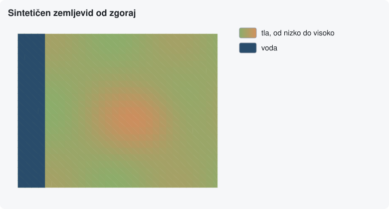

# Datoteke ravni in okvirji {#the-level-files-and-frames}

`<out>/<zemljevid>/<zemljevid>.glb` (raven: 3D model tal) in poleg njega `<zemljevid>.json`. Datoteka glb se
zapiše v `<zemljevid>.glb.part` in se preimenuje, ko je končana.

| Del | Kaj je |
|---|---|
| `ground:<zemljevid>` | višinska karta terena kot mreža, največ `--max-grid` vzorcev na stranico (privzeto 1024: približno 2 milijona trikotnikov) |
| `water:<zemljevid>` | reke, jezera in morje: ravne ploskve na višini vode, po ena na celico mreže, če je dovolj vzorcev njene višinske karte pod vodo (tretjina z masko vode zemljevida, polovica brez nje) |
| `ground:<zemljevid> towns` | poseljeni odtisi mest in vasi, položeni 1,5 m nad tla |

JSON hrani **vogale in škatlo zemljepisne širine in dolžine** zemljevida (`corners`, `extent`), kako so bili
najdeni (`georeference`), nastavitve višine (`heightMul`, `SeaLevel`), območje igranja v igrinih metrih
(`playArea`), okvir in njegovo izhodišče (`frame`, `geo`), števila trikotnikov in morebitne `notes`.

## Okvirji {#frames}

Dva okvirja, `--frame`:

- `enu` (privzeto): metri vzhodno, nadmorska višina nad morsko gladino, severno od izhodišča na tangentni
  ravnini WGS-84: ravni zemljevid, v katerega 3DHeat Watcher postavi posnetek IL-2 Tacview (x vzhod, y višina,
  z sever, risano z zrcaljenim z). Glb hrani (vzhod, višina, -sever). Pretvori z `--origin <lat> <lon>`,
  nastavljenim na `geo` posnetka (referenčna točka njegove seje), in posnetek pristane na ravni brez koraka
  postavljanja; brez tega je izhodišče središče zemljevida, `geo` v JSON pa pove, kateri je.
- `game`: igrini lastni metri, kot jih imajo datoteke misij: x sever od južnega roba, y igrina višina, z vzhod od
  zahodnega roba (desnosučno, kot je; torej glb = (x, y, z)). Zemljevidi, ki jih ni mogoče postaviti na Zemljo, se
  zapišejo v tem okvirju, ne glede na to, kaj je bilo zahtevano, z opombo.

Raven je binarni glTF z imenovanimi deli, kot je vsaka raven 3DHeat; stran pregledovalnika
[Ravni](https://holdi601.github.io/3DHeat/levels.html) pove, kako jih naloži.
