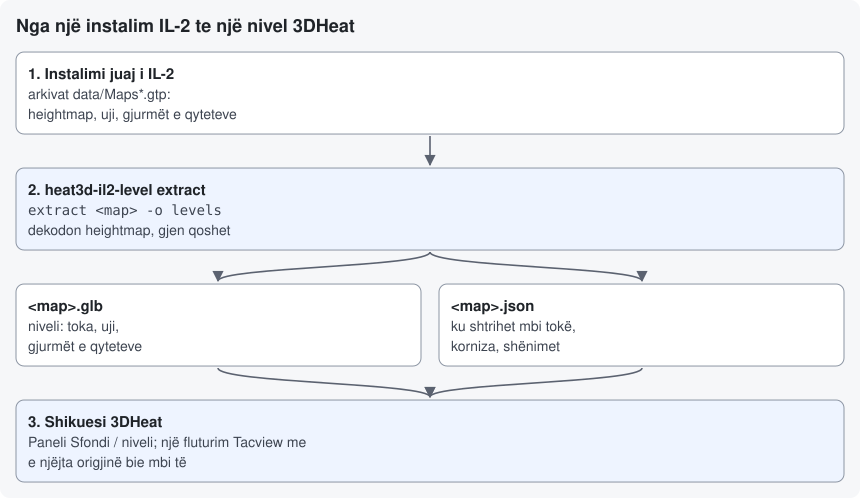

# 3DHeat IL-2 {#dheat-il-2}

**Çfarë është?** Një program i vogël që i kthen hartat e **IL-2 Sturmovik:
Great Battles**, të lexuara nga **instalimi yt**, në modele 3D - nivele -
mbi të cilat mund të fluturosh në shikuesin [3DHeat](https://github.com/Holdi601/3DHeat)
([dokumentacioni](https://holdi601.github.io/3DHeat/)): kodrat, lumenjtë,
liqenet, detin dhe qytetet, të vendosura aty ku shtrihen mbi tokë. Një lojë e dytë IL-2
arkivat e së cilës e fshehin tabelën e skedarëve lexohet aq sa e lejojnë arkivat
([detajet](archives-without-table.md)).

**Pse ta përdor?** Për t'i parë fluturimet e tua në IL-2 mbi hartën e vetë lojës.

**Shembull:** `heat3d-il2-level extract <map> -o levels` ->
`levels/<map>/<map>.glb` (niveli) + `<map>.json` (ku shtrihet mbi
tokë). Një heightmap është një rrjetë lartësish, si një hartë reliefi; një regjistrim
Tacview është një skedar fluturimi që e shkruan Tacview.

Për çfarë është e dobishme:

- **Fluturime mbi hartën e vetë lojës.** Një regjistrim IL-2 Tacview, i konvertuar nga
  3DHeat Watcher me të njëjtën origjinë, bie mbi nivel pa hap vendosjeje.
- **Çdo hartë njëherësh.** `extract --all` shkruan çdo hartë të gjetur; stinët që
  ndajnë të njëjtin heightmap shkruhen një herë.
- **Ku mbi tokë.** `.json` i çdo niveli mban qoshet dhe kutinë e tij të
  gjerësisë/gjatësisë gjeografike, dhe si u gjetën.



## Fillimi i shpejtë {#quick-start}

Je i ri me rreshtin e komandave? Lexo së pari [Para se të fillosh](before-you-start.md).
Ekzekuto këto në dosjen që klonove ose shpaketove:

```bash
python -m pip install -e .                         # installs the heat3d-il2-level command
python -m pip install -e .[fast]                            # with numba: decoding 20 to 50 times faster
heat3d-il2-level list                              # every map found, with its latitude/longitude box
heat3d-il2-level extract <map> -o levels           # one map (names as `list` prints them, wildcards allowed)
heat3d-il2-level extract --all -o levels           # every map
```

Duhet të shohësh një rresht për çdo hartë nga `list`, dhe `ok ...` nga `extract`.
Pastaj ngarko `levels/<map>/<map>.glb` te paneli Sfondi / niveli i shikuesit
([Levels](https://holdi601.github.io/3DHeat/levels.html)).

Nivelet që shkruan ndërtohen nga të dhënat e lojës: ato mbeten **në kompjuterin
tënd**; mos i publiko kurrë ([Kushtet](terms.md)).

## Faqet {#pages}

| Faqja | Çfarë mbulon |
|---|---|
| [Para se të fillosh](before-you-start.md) | Python, një terminal, një ekzekutim i parë |
| [Gjetja e hartave: list](list.md) | ku gjenden instalimet, çfarë shtyp `list` |
| [Ndërtimi i niveleve: extract](extract.md) | çdo opsion, hap pas hapi, shembuj |
| [Skedarët e nivelit dhe kornizat](output.md) | pjesët e `.glb`, `.json`, kornizat `enu` dhe `game` |
| [Si lexohen skedarët](reading.md) | arkivat, kodeku i heightmap, uji, qytetet, përshtatjet me pika referimi |
| [Arkiva pa tabelë skedarësh](archives-without-table.md) | loja e dytë, e lexuar aq sa e lejojnë arkivat e saj |
| [Shpejtësia, testet, kushtet](terms.md) | numba, testet, kushtet e lojës, licenca |
| [Referenca e komandave](../cli-reference.md) | çdo opsion, e gjeneruar nga kodi |
| [Mirëmbajtja e këtyre dokumenteve](maintaining.md) | lista e kontrollit të botimit |

## Të lidhura {#related}

- Shikuesi 3DHeat: [github.com/Holdi601/3DHeat](https://github.com/Holdi601/3DHeat),
  dokumentacioni te [holdi601.github.io/3DHeat](https://holdi601.github.io/3DHeat/).
- Telemetria për këto nivele: [3DHeat Watcher](https://holdi601.github.io/3DHeat-Watcher/)
  konverton regjistrimet IL-2 Tacview; formatet e skedarëve të shikuesit, përfshirë kontejnerin e tij
  një-skedar-për-ndeshje, përshkruhen te
  [One file a match (.3dheat)](https://holdi601.github.io/3DHeat/container.html).

## Mjetet 3DHeat {#the-3dheat-tools}

| Mjeti | Çfarë bën | Kodi | Dokumentet |
|---|---|---|---|
| Shikuesi 3DHeat | shfaq të dhënat: harta nxehtësie, analizë gare, rishikim ndeshjesh | [3DHeat](https://github.com/Holdi601/3DHeat) | [dokumentet](https://holdi601.github.io/3DHeat/) |
| GameFiles | nivele dhe pista nga skedarët e vetë lojës | [3DHeat-GameFiles](https://github.com/Holdi601/3DHeat-GameFiles) | [dokumentet](https://holdi601.github.io/3DHeat-GameFiles/) |
| GameCapture | telemetri xhirimesh, dhe nivele të rindërtuara nga video loje | [3DHeat-GameCapture](https://github.com/Holdi601/3DHeat-GameCapture) | [dokumentet](https://holdi601.github.io/3DHeat-GameCapture/) |
| Unreal Exporter | një shtojcë e Unreal Editor: një nivel si një `.glb` | [3DHeat-UnrealExporter](https://github.com/Holdi601/3DHeat-UnrealExporter) | [dokumentet](https://holdi601.github.io/3DHeat-UnrealExporter/) |
| CS2 | demo dhe harta të Counter-Strike 2 | [3DHeat-CS2](https://github.com/Holdi601/3DHeat-CS2) | [dokumentet](https://holdi601.github.io/3DHeat-CS2/) |
| Watcher | regjistron çfarë botojnë lojërat ndërsa luaj | [3DHeat-Watcher](https://github.com/Holdi601/3DHeat-Watcher) | [dokumentet](https://holdi601.github.io/3DHeat-Watcher/) |
| Ext-WarThunder | riluajtje të War Thunder | [3DHeat-Ext-WarThunder](https://github.com/Holdi601/3DHeat-Ext-WarThunder) | [dokumentet](https://holdi601.github.io/3DHeat-Ext-WarThunder/) |
| Ext-WoT | riluajtje të World of Tanks | [3DHeat-Ext-WoT](https://github.com/Holdi601/3DHeat-Ext-WoT) | [dokumentet](https://holdi601.github.io/3DHeat-Ext-WoT/) |
| Ext-WoWs | riluajtje të World of Warships | [3DHeat-Ext-WoWs](https://github.com/Holdi601/3DHeat-Ext-WoWs) | [dokumentet](https://holdi601.github.io/3DHeat-Ext-WoWs/) |
| Ext-Squad | demo serveri të Squad | [3DHeat-Ext-Squad](https://github.com/Holdi601/3DHeat-Ext-Squad) | [dokumentet](https://holdi601.github.io/3DHeat-Ext-Squad/) |
| Ext-DCS | harta të DCS World si nivele 3D | [3DHeat-Ext-DCS](https://github.com/Holdi601/3DHeat-Ext-DCS) | [dokumentet](https://holdi601.github.io/3DHeat-Ext-DCS/) |
| Ext-IL2 | harta të IL-2 Sturmovik si nivele 3D | [3DHeat-Ext-IL2](https://github.com/Holdi601/3DHeat-Ext-IL2) | [dokumentet](https://holdi601.github.io/3DHeat-Ext-IL2/) |
