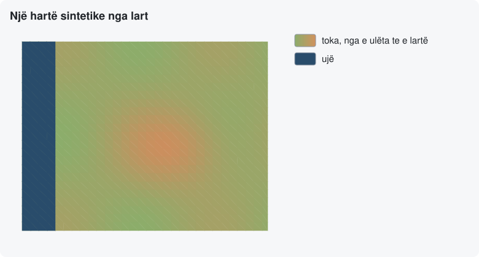

# Skedarët e nivelit dhe kornizat {#the-level-files-and-frames}

`<out>/<map>/<map>.glb` (niveli: një model 3D i tokës) dhe `<map>.json`
pranë tij. Glb shkruhet te
`<map>.glb.part` dhe riemërtohet kur përfundon.

| Pjesa | Çfarë është |
|---|---|
| `ground:<map>` | heightmap i terrenit si rrjetë, më së shumti `--max-grid` mostra për anë (parazgjedhja 1024: rreth 2 milionë trekëndësha) |
| `water:<map>` | lumenj, liqene dhe det: katërkëndësha të sheshtë në lartësinë e ujit, një për çdo qelizë rrjete të cilës mostrat e heightmap-it nën ujë i mjaftojnë (një e treta me maskën e ujit të hartës, gjysma pa të) |
| `ground:<map> towns` | gjurmët e ndërtuara të qyteteve dhe fshatrave, shtruar 1.5 m mbi tokë |

JSON mban **qoshet dhe kutinë e gjerësisë/gjatësisë gjeografike** të hartës (`corners`,
`extent`), si u gjetën (`georeference`), cilësimet e lartësisë
(`heightMul`, `SeaLevel`), zonën e lojës në metrat e lojës (`playArea`),
kornizën dhe origjinën e saj (`frame`, `geo`), numrat e trekëndëshave dhe çdo `notes`.

## Kornizat {#frames}

Dy korniza, `--frame`:

- `enu` (parazgjedhja): metra drejt lindjes, lartësi mbi nivelin e detit, drejt veriut nga një origjinë në
  rrafshin tangjent WGS-84: harta e sheshtë ku 3DHeat Watcher vendos një regjistrim IL-2 Tacview
  (x lindje, y lartësi, z veri, vizatuar me z të pasqyruar). Glb
  ruan (lindje, lartësi, -veri). Konverto me `--origin <lat> <lon>` të vendosur te
  `geo` i një regjistrimi (pika e referencës e seancës së tij) dhe regjistrimi bie mbi
  nivel pa hap vendosjeje; pa të, qendra e hartës është origjina,
  dhe `geo` i JSON thotë cila.
- `game`: metrat e vetë lojës siç i kanë skedarët e misioneve: x drejt veriut nga skaji
  jugor, y lartësia e lojës, z drejt lindjes nga skaji perëndimor (dorë e djathtë ashtu si
  është, pra glb = (x, y, z)). Hartat që nuk mund të vendosen mbi tokë shkruhen në
  këtë kornizë çfarëdo që u kërkua, me një shënim.

Niveli është një glTF binar me pjesë të emërtuara, si çdo nivel 3DHeat; faqja
[Levels](https://holdi601.github.io/3DHeat/levels.html) e shikuesit thotë si i ngarkon.
