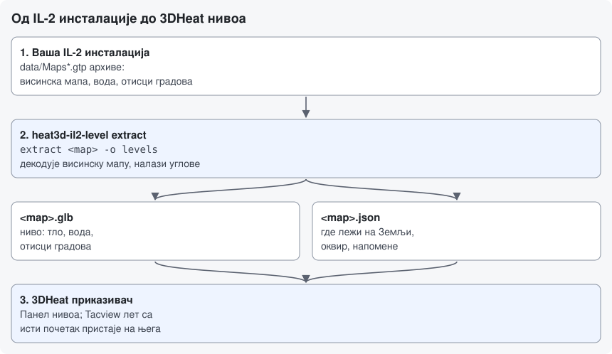

# 3DHeat IL-2 {#dheat-il-2}

**Шта је то?** Мали програм који претвара мапе игре **IL-2 Sturmovik:
Great Battles**, очитане из **ваше сопствене инсталације**, у 3D моделе - нивое -
преко којих можете да летите у [3DHeat](https://github.com/Holdi601/3DHeat) приказивачу
([документација](https://holdi601.github.io/3DHeat/)): брда, реке,
језера, море и градови, постављени онако како леже на Земљи. Друга IL-2 игра
чије архиве крију своју табелу датотека чита се онолико колико архиве дозвољавају
([детаљи](archives-without-table.md)).

**Зашто бих га користио?** Да видите своје IL-2 летове над мапом игре.

**Пример:** `heat3d-il2-level extract <map> -o levels` ->
`levels/<map>/<map>.glb` (ниво) + `<map>.json` (где лежи на
Земљи). Висинска мапа је мрежа висина, као рељефна карта; Tacview
снимак је датотека лета коју пише Tacview.

Чему служи:

- **Летови над мапом игре.** IL-2 Tacview снимак, претворен помоћу
  3DHeat Watcher-а с истим пореклом, пада на ниво без корака постављања.
- **Све мапе одједном.** `extract --all` пише сваку пронађену мапу; сезоне које
  деле исту висинску мапу пишу се једном.
- **Где на Земљи.** `.json` сваког нивоа носи своје углове и кутију географске
  ширине и дужине, и како су нађени.



## Брзи почетак {#quick-start}

Први пут у командној линији? Прво прочитајте [Пре почетка](before-you-start.md).
Покрените ово у фасцикли у коју сте клонирали или распаковали алат:

```bash
python -m pip install -e .                         # инсталира команду heat3d-il2-level
python -m pip install -e .[fast]                   # с numba: декодовање 20 до 50 пута брже
heat3d-il2-level list                              # свака пронађена мапа, са кутијом географске ширине и дужине
heat3d-il2-level extract <map> -o levels           # једна мапа (имена као што их `list` исписује, џокери дозвољени)
heat3d-il2-level extract --all -o levels           # свака мапа
```

Требало би да видите по ред за сваку мапу из `list`, а `ok ...` из `extract`.
Затим учитајте `levels/<map>/<map>.glb` на панел Позадина / ниво приказивача
([Нивои](https://holdi601.github.io/3DHeat/levels.html)).

Нивои које алат пише састављени су од игриних података: остају **на вашем
рачунару**; никад их не објављујте ([Услови](terms.md)).

## Странице {#pages}

| Страница | Шта обухвата |
|---|---|
| [Пре почетка](before-you-start.md) | Python, терминал, прво покретање |
| [Налажење мапа: list](list.md) | где се инсталације налазе, шта `list` исписује |
| [Прављење нивоа: extract](extract.md) | свака опција, корак по корак, примери |
| [Датотеке нивоа и оквири](output.md) | `.glb` делови, `.json`, оквири `enu` и `game` |
| [Како се датотеке читају](reading.md) | архиве, кодек висинске мапе, вода, градови, уклапање по орјентирима |
| [Архиве без табеле датотека](archives-without-table.md) | друга игра, читана онолико колико њене архиве дозвољавају |
| [Брзина, тестови, услови](terms.md) | numba, тестови, услови игре, лиценца |
| [Референца команди](../cli-reference.md) | свака опција, генерисано из кода |
| [Одржавање ове документације](maintaining.md) | контролна листа за издање |

## Повезано {#related}

- 3DHeat приказивач: [github.com/Holdi601/3DHeat](https://github.com/Holdi601/3DHeat),
  документација на [holdi601.github.io/3DHeat](https://holdi601.github.io/3DHeat/).
- Телеметрија за ове нивое: [3DHeat Watcher](https://holdi601.github.io/3DHeat-Watcher/)
  претвара IL-2 Tacview снимке; формати датотека приказивача, укључујући његов
  контејнер једног меча у једној датотеци, описани су у
  [Једна датотека по мечу (.3dheat)](https://holdi601.github.io/3DHeat/container.html).

## Алати 3DHeat-а {#the-3dheat-tools}

| Алат | Шта ради | Код | Документација |
|---|---|---|---|
| 3DHeat приказивач | приказује податке: топлотне мапе, анализу трке, преглед мечева | [3DHeat](https://github.com/Holdi601/3DHeat) | [документација](https://holdi601.github.io/3DHeat/) |
| GameFiles | нивои и стазе из сопствених датотека игре | [3DHeat-GameFiles](https://github.com/Holdi601/3DHeat-GameFiles) | [документација](https://holdi601.github.io/3DHeat-GameFiles/) |
| GameCapture | телеметрија кругова, и нивои реконструисани из снимка игре | [3DHeat-GameCapture](https://github.com/Holdi601/3DHeat-GameCapture) | [документација](https://holdi601.github.io/3DHeat-GameCapture/) |
| Unreal Exporter | додатак за Unreal Editor: ниво као један `.glb` | [3DHeat-UnrealExporter](https://github.com/Holdi601/3DHeat-UnrealExporter) | [документација](https://holdi601.github.io/3DHeat-UnrealExporter/) |
| CS2 | Counter-Strike 2 демои и мапе | [3DHeat-CS2](https://github.com/Holdi601/3DHeat-CS2) | [документација](https://holdi601.github.io/3DHeat-CS2/) |
| Watcher | бележи оно што игре објављују док играте | [3DHeat-Watcher](https://github.com/Holdi601/3DHeat-Watcher) | [документација](https://holdi601.github.io/3DHeat-Watcher/) |
| Ext-WarThunder | War Thunder репризе | [3DHeat-Ext-WarThunder](https://github.com/Holdi601/3DHeat-Ext-WarThunder) | [документација](https://holdi601.github.io/3DHeat-Ext-WarThunder/) |
| Ext-WoT | World of Tanks репризе | [3DHeat-Ext-WoT](https://github.com/Holdi601/3DHeat-Ext-WoT) | [документација](https://holdi601.github.io/3DHeat-Ext-WoT/) |
| Ext-WoWs | World of Warships репризе | [3DHeat-Ext-WoWs](https://github.com/Holdi601/3DHeat-Ext-WoWs) | [документација](https://holdi601.github.io/3DHeat-Ext-WoWs/) |
| Ext-Squad | Squad демои са сервера | [3DHeat-Ext-Squad](https://github.com/Holdi601/3DHeat-Ext-Squad) | [документација](https://holdi601.github.io/3DHeat-Ext-Squad/) |
| Ext-DCS | DCS World мапе као 3D нивои | [3DHeat-Ext-DCS](https://github.com/Holdi601/3DHeat-Ext-DCS) | [документација](https://holdi601.github.io/3DHeat-Ext-DCS/) |
| Ext-IL2 | мапе IL-2 Sturmovik као 3D нивои | [3DHeat-Ext-IL2](https://github.com/Holdi601/3DHeat-Ext-IL2) | [документација](https://holdi601.github.io/3DHeat-Ext-IL2/) |
