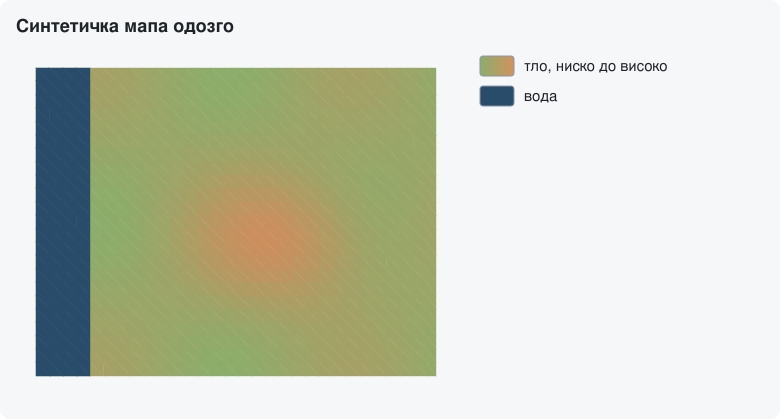

# Датотеке нивоа и оквири {#the-level-files-and-frames}

`<out>/<map>/<map>.glb` (ниво: 3D модел тла) и `<map>.json` поред њега. `.glb` се пише у
`<map>.glb.part` и преименује се кад је готов.

| Део | Шта је |
|---|---|
| `ground:<map>` | висинска мапа терена као мрежа, највише `--max-grid` узорака по страни (подразумевано 1024: око два милиона троуглова) |
| `water:<map>` | реке, језера и море: равни четвороуглови на висини воде, по један за сваку ћелију мреже у којој има довољно узорака висинске мапе испод воде (трећина са маском воде мапе, половина без ње) |
| `ground:<map> towns` | изграђене површине градова и села, положене 1,5 m изнад тла |

JSON носи **углове и кутију географске ширине и дужине** мапе (`corners`,
`extent`), како су нађени (`georeference`), подешавања висине
(`heightMul`, `SeaLevel`), подручје игре у игриним метрима (`playArea`), оквир и
његов почетак (`frame`, `geo`), бројеве троуглова и све `notes`.

## Оквири {#frames}

Два оквира, `--frame`:

- `enu` (подразумевано): метри источно, висина изнад нивоа мора, метри северно од
  почетка на WGS-84 тангентној равни: равна мапа у коју Watcher ставља IL-2 Tacview
  снимак (x источно, y висина, z северно, црта се са пресликаним z). glb
  чува (источно, висина, -северно). Задајте `--origin <lat> <lon>` да буде једнак
  `geo` снимка (референтна тачка његове сесије) и снимак пада на ниво без корака
  постављања; без тога је центар мапе почетак, а `geo` у JSON-у каже који.
- `game`: игрини сопствени метри, онакви какве их имају датотеке мисија: x север од
  јужне ивице, y игрина висина, z исток од западне ивице (десноруко како јесте, па је
  glb = (x, y, z)). Мапе које не могу да се сместе на Земљу пишу се у овом оквиру,
  шта год да је тражено, са напоменом.

Ниво је glTF бинарна датотека са именованим деловима, као сваки 3DHeat ниво; страница
приказивача [Нивои](https://holdi601.github.io/3DHeat/levels.html) каже како их учитава.
