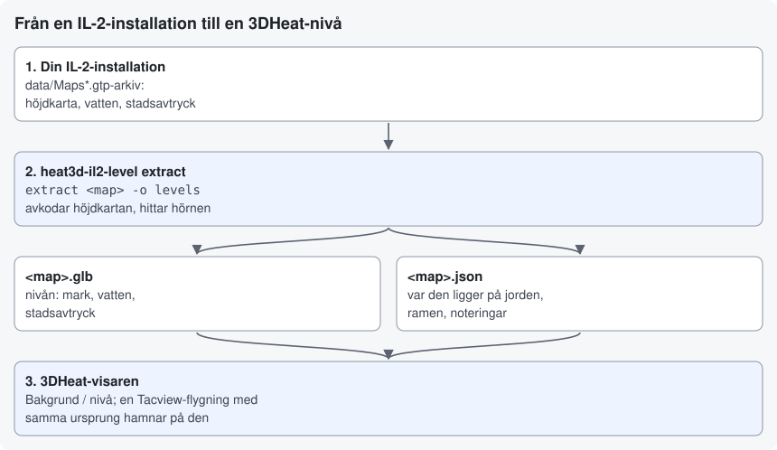

# 3DHeat IL-2 {#dheat-il-2}

**Vad är det?** Ett litet program som gör kartorna i **IL-2 Sturmovik:
Great Battles**, lästa från **din egen installation**, till 3D-modeller - nivåer -
som du kan flyga över i [3DHeat](https://github.com/Holdi601/3DHeat)-visaren
([dokumentation](https://holdi601.github.io/3DHeat/)): kullarna, floderna,
sjöarna, havet och städerna, placerade där de ligger på jorden. Ett andra IL-2-spel
vars arkiv döljer deras filtabell läses så långt arkiven tillåter
([detaljer](archives-without-table.md)).

**Varför skulle jag använda det?** För att se dina IL-2-flygningar över spelets egen karta.

**Exempel:** `heat3d-il2-level extract <map> -o levels` ->
`levels/<map>/<map>.glb` (nivån) + `<map>.json` (var den ligger på jorden). En höjdkarta är ett rutnät av höjder, som en reliefkarta; en Tacview-inspelning är en fil med en flygning som Tacview skriver.

Det här är användbart för:

- **Flygningar på spelets egen karta.** En IL-2 Tacview-inspelning, konverterad av 3DHeat Watcher med samma ursprung, hamnar på nivån utan något placeringssteg.
- **Varje karta på en gång.** `extract --all` skriver varje karta som hittas; säsonger som delar en höjdkarta skrivs en gång.
- **Var på jorden.** Varje nivås `.json` bär sina hörn och latitud/longitud-ruta, och hur de hittades.



## Snabbstart {#quick-start}

Har du aldrig använt kommandoraden förut? Läs [Innan du börjar](before-you-start.md) först.
Kör dessa i mappen du klonade eller packade upp:

```bash
python -m pip install -e .                         # installerar kommandot heat3d-il2-level
python -m pip install -e .[fast]                            # med numba: avkodningen 20 till 50 gånger snabbare
heat3d-il2-level list                              # varje karta som hittas, med dess latitud/longitud-ruta
heat3d-il2-level extract <map> -o levels           # en karta (namn så som `list` skriver dem, jokertecken tillåtna)
heat3d-il2-level extract --all -o levels           # varje karta
```

Du ser en rad per karta från `list`, och `ok ...` från `extract`.
Läs sedan in `levels/<map>/<map>.glb` i visarens panel Bakgrund / nivå
([Nivåer](https://holdi601.github.io/3DHeat/levels.html)).

Nivåerna den skriver är byggda av spelets data: de stannar på **din dator**; publicera dem aldrig ([Villkor](terms.md)).

## Sidor {#pages}

| Sida | Vad den täcker |
|---|---|
| [Innan du börjar](before-you-start.md) | Python, en terminal, en första körning |
| [Hitta kartor: list](list.md) | var installationerna hittas, vad `list` skriver ut |
| [Bygga nivåer: extract](extract.md) | varje alternativ, steg för steg, exempel |
| [Nivåfilerna och ramarna](output.md) | delarna `.glb`, `.json`, ramarna `enu` och `game` |
| [Så läses filerna](reading.md) | arkiven, höjdkartans kodek, vatten, städer, landmärkesanpassningar |
| [Arkiv utan filtabell](archives-without-table.md) | det andra spelet, läst så långt dess arkiv tillåter |
| [Hastighet, tester, villkor](terms.md) | numba, testerna, spelets villkor, licens |
| [Kommandoreferens](../cli-reference.md) | varje alternativ, genererat från koden |
| [Underhålla dokumentationen](maintaining.md) | checklistan för utgivning |

## Relaterat {#related}

- 3DHeat-visaren: [github.com/Holdi601/3DHeat](https://github.com/Holdi601/3DHeat),
  dokumentation på [holdi601.github.io/3DHeat](https://holdi601.github.io/3DHeat/).
- Telemetri för de här nivåerna: [3DHeat Watcher](https://holdi601.github.io/3DHeat-Watcher/)
  konverterar IL-2 Tacview-inspelningar; visarens filformat, inklusive behållaren som samlar en match i en fil,
  beskrivs i [En fil per match (.3dheat)](https://holdi601.github.io/3DHeat/container.html).

## 3DHeat-verktygen {#the-3dheat-tools}

| Verktyg | Vad det gör | Kod | Dokumentation |
|---|---|---|---|
| 3DHeat-visaren | visar datan: värmekartor, Racinganalys, matchgenomgång | [3DHeat](https://github.com/Holdi601/3DHeat) | [dokumentation](https://holdi601.github.io/3DHeat/) |
| GameFiles | nivåer och banor från ett spels egna filer | [3DHeat-GameFiles](https://github.com/Holdi601/3DHeat-GameFiles) | [dokumentation](https://holdi601.github.io/3DHeat-GameFiles/) |
| GameCapture | varvtelemetri, och nivåer återskapade från spelvideo | [3DHeat-GameCapture](https://github.com/Holdi601/3DHeat-GameCapture) | [dokumentation](https://holdi601.github.io/3DHeat-GameCapture/) |
| Unreal Exporter | ett Unreal Editor-tillägg: en nivå som en `.glb`-fil | [3DHeat-UnrealExporter](https://github.com/Holdi601/3DHeat-UnrealExporter) | [dokumentation](https://holdi601.github.io/3DHeat-UnrealExporter/) |
| CS2 | Counter-Strike 2-demos och kartor | [3DHeat-CS2](https://github.com/Holdi601/3DHeat-CS2) | [dokumentation](https://holdi601.github.io/3DHeat-CS2/) |
| Watcher | spelar in det spel publicerar medan du spelar | [3DHeat-Watcher](https://github.com/Holdi601/3DHeat-Watcher) | [dokumentation](https://holdi601.github.io/3DHeat-Watcher/) |
| Ext-WarThunder | War Thunder-repriser | [3DHeat-Ext-WarThunder](https://github.com/Holdi601/3DHeat-Ext-WarThunder) | [dokumentation](https://holdi601.github.io/3DHeat-Ext-WarThunder/) |
| Ext-WoT | World of Tanks-repriser | [3DHeat-Ext-WoT](https://github.com/Holdi601/3DHeat-Ext-WoT) | [dokumentation](https://holdi601.github.io/3DHeat-Ext-WoT/) |
| Ext-WoWs | World of Warships-repriser | [3DHeat-Ext-WoWs](https://github.com/Holdi601/3DHeat-Ext-WoWs) | [dokumentation](https://holdi601.github.io/3DHeat-Ext-WoWs/) |
| Ext-Squad | Squad-serverdemos | [3DHeat-Ext-Squad](https://github.com/Holdi601/3DHeat-Ext-Squad) | [dokumentation](https://holdi601.github.io/3DHeat-Ext-Squad/) |
| Ext-DCS | DCS World-kartor som 3D-nivåer | [3DHeat-Ext-DCS](https://github.com/Holdi601/3DHeat-Ext-DCS) | [dokumentation](https://holdi601.github.io/3DHeat-Ext-DCS/) |
| Ext-IL2 | IL-2 Sturmovik-kartor som 3D-nivåer | [3DHeat-Ext-IL2](https://github.com/Holdi601/3DHeat-Ext-IL2) | [dokumentation](https://holdi601.github.io/3DHeat-Ext-IL2/) |
