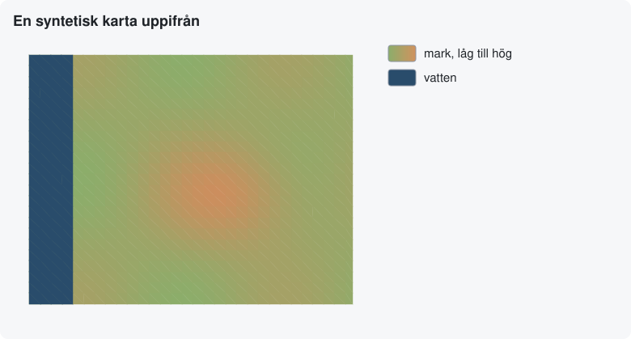

# Nivåfilerna och ramarna {#the-level-files-and-frames}

`<out>/<map>/<map>.glb` (nivån: en 3D-modell av marken) och `<map>.json`
bredvid den. Glb-filen skrivs till
`<map>.glb.part` och byter namn när den är klar.

| Del | Vad den är |
|---|---|
| `ground:<map>` | terrängens höjdkarta som ett rutnät, högst `--max-grid` prov per sida (standard 1024: ungefär 2 miljoner trianglar) |
| `water:<map>` | floder, sjöar och hav: platta fyrhörningar på vattnets höjd, en per rutcell där tillräckligt många av höjdkartans prov ligger under vatten (en tredjedel med kartans vattenmask, hälften utan) |
| `ground:<map> towns` | de bebyggda avtrycken av städer och byar, draperade 1,5 m över marken |

JSON-filen innehåller kartans **hörn och latitud/longitud-ruta** (`corners`,
`extent`), hur de hittades (`georeference`), höjdinställningarna
(`heightMul`, `SeaLevel`), spelområdet i spelets meter (`playArea`), ramen och dess
ursprung (`frame`, `geo`), antal trianglar och eventuella `notes`.

## Ramar {#frames}

Två ramar, `--frame`:

- `enu` (standard): meter öster, höjd över havet, norr om ett ursprung på WGS-84:s tangentplan: den platta kartan som 3DHeat Watcher lägger en IL-2 Tacview-inspelning i (x öster, y höjd, z norr, ritad med z speglad). glb:n lagrar (öster, höjd, -norr). Konvertera med `--origin <lat> <lon>` satt till inspelningens `geo` (dess sessions referenspunkt) så hamnar inspelningen på nivån utan något placeringssteg; utan den är kartans mitt ursprunget, och JSON:ens `geo` säger vilket.
- `game`: spelets egna meter så som uppdragsfiler har dem: x norrut från södra kanten, y spelets höjd, z österut från västra kanten (högerhänt som den är, så glb = (x, y, z)). Kartor som inte kan placeras på jorden skrivs i den här ramen oavsett vad som begärdes, med en notering.

Nivån är en glTF-binärfil med namngivna delar, som alla 3DHeat-nivåer är; visarens
[Nivåer](https://holdi601.github.io/3DHeat/levels.html)-sida beskriver hur den läser in dem.
