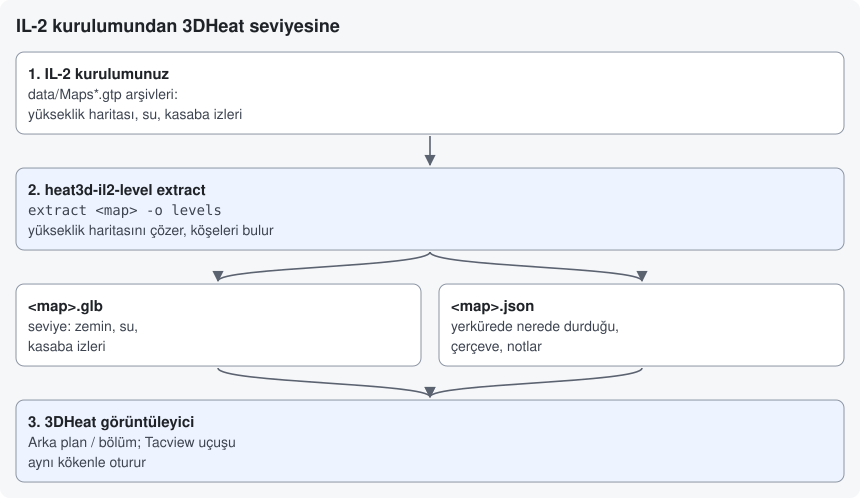

# 3DHeat IL-2 {#dheat-il-2}

**Nedir?** **IL-2 Sturmovik: Great Battles** haritalarını, **kendi kurulumunuzdan** okuyup 3D modellere (seviyelere) çeviren küçük bir program. Bu modeller, [3DHeat](https://github.com/Holdi601/3DHeat) görüntüleyicisinde üstünden uçabileceğiniz seviyelerdir ([belgeler](https://holdi601.github.io/3DHeat/)): tepeler, nehirler, göller, deniz ve kasabalar, yerkürede durdukları yerde. Arşivlerinde dosya tablosunu gizleyen ikinci bir IL-2 oyunu da, arşivlerin izin verdiği ölçüde okunur ([ayrıntılar](archives-without-table.md)).

**Neden kullanmalıyım?** IL-2 uçuşlarınızı oyunun kendi haritasında görmek için.

**Örnek:** `heat3d-il2-level extract <map> -o levels` -> `levels/<map>/<map>.glb` (seviye) + `<map>.json` (yerkürede nerede durduğu). Yükseklik haritası, kabartma haritası gibi bir yükseklik ızgarasıdır; Tacview kaydı ise Tacview'un yazdığı bir uçuş dosyasıdır.

Bu şunlar için işe yarar:

- **Oyunun kendi haritasında uçuşlar.** 3DHeat Watcher'ın aynı kökenle dönüştürdüğü bir IL-2 Tacview kaydı, yerleştirme adımı olmadan seviyeye oturur.
- **Tüm haritalar birden.** `extract --all` bulunan her haritayı yazar; aynı yükseklik haritasını paylaşan mevsimler bir kez yazılır.
- **Yerkürede nerede.** Her seviyenin `.json` dosyası köşelerini ve enlem/boylam kutusunu, bunların nasıl bulunduğuyla birlikte taşır.



## Hızlı başlangıç {#quick-start}

Komut satırında yeni misiniz? Önce [Başlamadan önce](before-you-start.md) sayfasını okuyun. Bunları klonladığınız ya da açtığınız klasörde çalıştırın:

```bash
python -m pip install -e .                         # heat3d-il2-level komutunu kurar
python -m pip install -e .[fast]                            # numba ile: çözme 20 ila 50 kat daha hızlı
heat3d-il2-level list                              # bulunan her harita, enlem/boylam kutusuyla
heat3d-il2-level extract <map> -o levels           # tek bir harita (`list`in yazdığı adlar; joker karakter serbest)
heat3d-il2-level extract --all -o levels           # her harita
```

`list` komutundan her harita için bir satır, `extract` komutundan ise `ok ...` görmelisiniz. Sonra `levels/<map>/<map>.glb` dosyasını görüntüleyicinin Arka plan / bölüm panelinde yükleyin ([Seviyeler](https://holdi601.github.io/3DHeat/levels.html)).

Yazdığı seviyeler oyunun verilerinden yapılır: **kendi makinenizde** kalırlar; asla yayımlamayın ([Koşullar](terms.md)).

## Sayfalar {#pages}

| Sayfa | Neyi anlatır |
|---|---|
| [Başlamadan önce](before-you-start.md) | Python, bir terminal, ilk çalıştırma |
| [Haritaları bulma: list](list.md) | kurulumların nerede bulunduğu, `list`'in ne yazdığı |
| [Seviyeleri oluşturma: extract](extract.md) | her seçenek, adım adım, örnekler |
| [Seviye dosyaları ve çerçeveler](output.md) | `.glb` parçaları, `.json`, `enu` ve `game` çerçeveleri |
| [Dosyalar nasıl okunur](reading.md) | arşivler, yükseklik haritası kodlayıcısı, su, kasabalar, yer işareti uydurmaları |
| [Dosya tablosu olmayan arşivler](archives-without-table.md) | ikinci oyun, arşivlerin izin verdiği ölçüde |
| [Hız, testler, koşullar](terms.md) | numba, testler, oyunun koşulları, lisans |
| [Komut başvurusu](../cli-reference.md) | her seçenek, koddan üretilmiş |
| [Bu belgelerin bakımı](maintaining.md) | sürüm kontrol listesi |

## İlgili {#related}

- 3DHeat görüntüleyici: [github.com/Holdi601/3DHeat](https://github.com/Holdi601/3DHeat), belgeleri [holdi601.github.io/3DHeat](https://holdi601.github.io/3DHeat/) adresinde.
- Bu seviyelerin telemetrisi: [3DHeat Watcher](https://holdi601.github.io/3DHeat-Watcher/) IL-2 Tacview kayıtlarını dönüştürür. Görüntüleyicinin dosya biçimleri, maç başına tek dosyalık kapsayıcı dahil, [Maç başına tek dosya (.3dheat)](https://holdi601.github.io/3DHeat/container.html) sayfasında anlatılır.

## 3DHeat araçları {#the-3dheat-tools}

| Araç | Ne yapar | Kod | Belgeler |
|---|---|---|---|
| 3DHeat görüntüleyici | verileri gösterir: ısı haritaları, yarış analizi, maç incelemesi | [3DHeat](https://github.com/Holdi601/3DHeat) | [belgeler](https://holdi601.github.io/3DHeat/) |
| GameFiles | bir oyunun kendi dosyalarından seviyeler ve parkurlar | [3DHeat-GameFiles](https://github.com/Holdi601/3DHeat-GameFiles) | [belgeler](https://holdi601.github.io/3DHeat-GameFiles/) |
| GameCapture | tur telemetrisi ve oynanış videosundan yeniden kurulan seviyeler | [3DHeat-GameCapture](https://github.com/Holdi601/3DHeat-GameCapture) | [belgeler](https://holdi601.github.io/3DHeat-GameCapture/) |
| Unreal Exporter | bir Unreal Editor eklentisi: bir seviye tek bir `.glb` olarak | [3DHeat-UnrealExporter](https://github.com/Holdi601/3DHeat-UnrealExporter) | [belgeler](https://holdi601.github.io/3DHeat-UnrealExporter/) |
| CS2 | Counter-Strike 2 demoları ve haritaları | [3DHeat-CS2](https://github.com/Holdi601/3DHeat-CS2) | [belgeler](https://holdi601.github.io/3DHeat-CS2/) |
| Watcher | oynarken oyunların yayımladıklarını kaydeder | [3DHeat-Watcher](https://github.com/Holdi601/3DHeat-Watcher) | [belgeler](https://holdi601.github.io/3DHeat-Watcher/) |
| Ext-WarThunder | War Thunder tekrarları | [3DHeat-Ext-WarThunder](https://github.com/Holdi601/3DHeat-Ext-WarThunder) | [belgeler](https://holdi601.github.io/3DHeat-Ext-WarThunder/) |
| Ext-WoT | World of Tanks tekrarları | [3DHeat-Ext-WoT](https://github.com/Holdi601/3DHeat-Ext-WoT) | [belgeler](https://holdi601.github.io/3DHeat-Ext-WoT/) |
| Ext-WoWs | World of Warships tekrarları | [3DHeat-Ext-WoWs](https://github.com/Holdi601/3DHeat-Ext-WoWs) | [belgeler](https://holdi601.github.io/3DHeat-Ext-WoWs/) |
| Ext-Squad | Squad sunucu demoları | [3DHeat-Ext-Squad](https://github.com/Holdi601/3DHeat-Ext-Squad) | [belgeler](https://holdi601.github.io/3DHeat-Ext-Squad/) |
| Ext-DCS | DCS World haritaları 3B seviyeler olarak | [3DHeat-Ext-DCS](https://github.com/Holdi601/3DHeat-Ext-DCS) | [belgeler](https://holdi601.github.io/3DHeat-Ext-DCS/) |
| Ext-IL2 | IL-2 Sturmovik haritaları 3B seviyeler olarak | [3DHeat-Ext-IL2](https://github.com/Holdi601/3DHeat-Ext-IL2) | [belgeler](https://holdi601.github.io/3DHeat-Ext-IL2/) |
