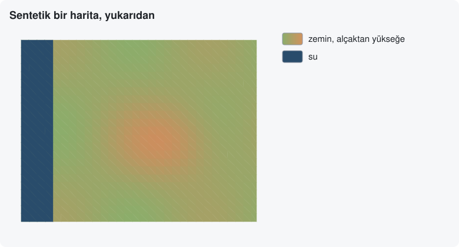

# Seviye dosyaları ve çerçeveler {#the-level-files-and-frames}

`<out>/<map>/<map>.glb` (seviye: zeminin 3B modeli) ve yanındaki `<map>.json`. glb, `<map>.glb.part` olarak yazılır ve tamamlanınca yeniden adlandırılır.

| Parça | Nedir |
|---|---|
| `ground:<map>` | arazinin yükseklik haritası, bir ızgara olarak; bir kenarda en fazla `--max-grid` örnek (varsayılan 1024: yaklaşık 2 milyon üçgen) |
| `water:<map>` | nehirler, göller ve deniz: suyun yüksekliğinde düz dörtgenler; yükseklik haritası örneklerinin yeterli kısmı su altındaki her ızgara hücresi için bir tane (su maskesiyle üçte bir, maske olmadan yarısı) |
| `ground:<map> towns` | kasaba ve köylerin yapılaşmış izleri, zeminin 1,5 m üzerine serilmiş |

JSON, haritanın **köşelerini ve enlem/boylam kutusunu** (`corners`, `extent`), bunların nasıl bulunduğunu (`georeference`), yükseklik ayarlarını (`heightMul`, `SeaLevel`), oyunun metrelerindeki oyun alanını (`playArea`), çerçeveyi ve başlangıç noktasını (`frame`, `geo`), üçgen sayılarını ve varsa `notes` notlarını tutar.

## Çerçeveler {#frames}

İki çerçeve vardır, `--frame` ile seçilir:

- `enu` (varsayılan): `--origin`in doğusunda metre, deniz seviyesinin üstünde rakım, kuzeyinde; WGS-84 teğet düzlemi üzerinde bir başlangıç noktası. Bu, Watcher'ın bir IL-2 Tacview kaydını koyduğu düz haritadır (x doğu, y rakım, z kuzey; z aynalanmış çizilir). glb, (doğu, rakım, -kuzey) saklar. Bir kaydın `geo`'sunu (oturumunun referans noktasını) `--origin <lat> <lon>` ile verin; kayıt yerleştirme adımı olmadan seviyeye oturur. Bu olmadan haritanın merkezi başlangıç noktasıdır ve JSON'un `geo` değeri hangisi olduğunu söyler.
- `game`: harita dosyalarında olduğu gibi oyunun kendi metreleri: x güney kenarından kuzey, y oyunun yüksekliği, z batı kenarından doğu (olduğu gibi sağ elli; bu yüzden glb = (x, y, z)). Yerkürede yerleştirilemeyen haritalar, ne istenirse istensin, bir notla birlikte bu çerçevede yazılır.

Seviye, her 3DHeat seviyesi gibi adlandırılmış parçaları olan bir glTF ikilisidir; görüntüleyicinin [Seviyeler](https://holdi601.github.io/3DHeat/levels.html) sayfası onları nasıl yüklediğini anlatır.
