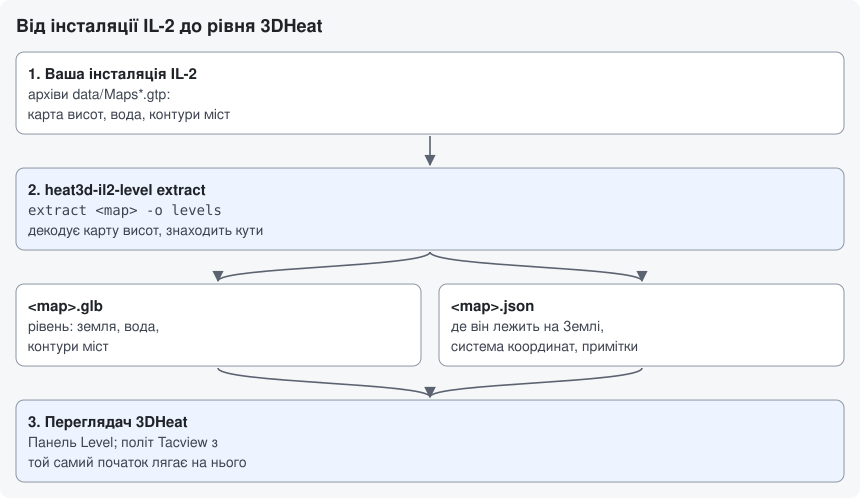

# 3DHeat IL-2 {#dheat-il-2}

**Що це?** Невелика програма, яка перетворює карти **IL-2 Sturmovik: Great Battles**,
прочитані з **вашої власної інсталяції**, на 3D-моделі — рівні — над якими можна
летіти в переглядачі [3DHeat](https://github.com/Holdi601/3DHeat)
([документація](https://holdi601.github.io/3DHeat/)): пагорби, річки, озера, море
і міста, розташовані там, де вони лежать на Землі. Друга гра IL-2, чиї архіви
приховують свою таблицю файлів, читається настільки, наскільки це дозволяють архіви
([докладніше](archives-without-table.md)).

**Навіщо це потрібно?** Щоб бачити свої польоти IL-2 на власній карті гри.

**Приклад:** `heat3d-il2-level extract <map> -o levels` ->
`levels/<map>/<map>.glb` (рівень) + `<map>.json` (де він лежить на Землі). Карта
висот — це сітка висот, схожа на рельєфну карту; запис Tacview — це файл польоту,
який записує Tacview.

Для чого це корисно:

- **Польоти на власній карті гри.** Запис Tacview з IL-2, перетворений 3DHeat Watcher
  з тим самим початком, лягає на рівень без жодного кроку розміщення.
- **Усі карти одразу.** `extract --all` записує кожну знайдену карту; сезони, які
  мають спільну карту висот, записуються один раз.
- **Де на Землі.** `.json` кожного рівня містить його кути і коробку широти/довготи,
  а також те, як їх знайдено.



## Швидкий старт {#quick-start}

Ви лише починаєте працювати з командним рядком? Спершу прочитайте
[Перш ніж почати](before-you-start.md). Виконуйте ці команди в папці, куди ви
клонували або розпакували інструмент:

```bash
python -m pip install -e .                         # встановлює команду heat3d-il2-level
python -m pip install -e .[fast]                            # з numba: декодування в 20-50 разів швидше
heat3d-il2-level list                              # кожна знайдена карта з коробкою широти/довготи
heat3d-il2-level extract <map> -o levels           # одна карта (назви, як їх виводить `list`, з маскою * дозволено)
heat3d-il2-level extract --all -o levels           # кожна карта
```

Ви маєте побачити рядок на кожну карту з `list` і `ok ...` від `extract`.
Потім завантажте `levels/<map>/<map>.glb` у панелі «Тло / рівень» переглядача
([Рівні](https://holdi601.github.io/3DHeat/levels.html)).

Рівні, які він записує, побудовано з даних гри, тож вони лишаються **на вашому
комп'ютері**; ніколи не публікуйте їх ([Умови](terms.md)).

Кожен читач гри — окремий невеликий проєкт із власним файлом ліцензії, власними релізами та власним трекером задач, тож його можна встановлювати, оновлювати, підтримувати - або відкликати на прохання правовласника - окремо, не зачіпаючи переглядач та інші інструменти.

## Сторінки {#pages}

| Сторінка | Що в ній |
|---|---|
| [Перш ніж почати](before-you-start.md) | Python, термінал, перший запуск |
| [Пошук карт: list](list.md) | де знаходяться інсталяції, що виводить `list` |
| [Побудова рівнів: extract](extract.md) | кожен параметр, крок за кроком, приклади |
| [Файли рівня і системи координат](output.md) | частини `.glb`, `.json`, системи координат `enu` і `game` |
| [Як читаються файли](reading.md) | архіви, кодек карти висот, вода, міста, прив'язка за орієнтирами |
| [Архіви без таблиці файлів](archives-without-table.md) | друга гра, читається настільки, наскільки дозволяють її архіви |
| [Швидкість, тести, умови](terms.md) | numba, тести, що читається і що не постачається, ліцензія |
| [Довідка з команд](../cli-reference.md) | кожен параметр, створений з коду |
| [Підтримка цих документів](maintaining.md) | контрольний список для випуску |

## Пов'язане {#related}

- Переглядач 3DHeat: [github.com/Holdi601/3DHeat](https://github.com/Holdi601/3DHeat),
  документація на [holdi601.github.io/3DHeat](https://holdi601.github.io/3DHeat/).
- Телеметрія для цих рівнів: [3DHeat Watcher](https://holdi601.github.io/3DHeat-Watcher/)
  перетворює записи Tacview з IL-2; формати файлів переглядача, зокрема його контейнер
  один файл на матч, описано в [Один файл на матч (.3dheat)](https://holdi601.github.io/3DHeat/container.html).

## Інструменти 3DHeat {#the-3dheat-tools}

| Інструмент | Що робить | Код | Документація |
|---|---|---|---|
| Переглядач 3DHeat | показує дані: теплові карти, аналіз заїздів, огляд матчів | [3DHeat](https://github.com/Holdi601/3DHeat) | [документація](https://holdi601.github.io/3DHeat/) |
| GameFiles | рівні й траси з власних файлів гри | [3DHeat-GameFiles](https://github.com/Holdi601/3DHeat-GameFiles) | [документація](https://holdi601.github.io/3DHeat-GameFiles/) |
| GameCapture | телеметрія кіл, а також рівні, відтворені з відео ігрового процесу | [3DHeat-GameCapture](https://github.com/Holdi601/3DHeat-GameCapture) | [документація](https://holdi601.github.io/3DHeat-GameCapture/) |
| Unreal Exporter | плагін для Unreal Editor: рівень як один `.glb` | [3DHeat-UnrealExporter](https://github.com/Holdi601/3DHeat-UnrealExporter) | [документація](https://holdi601.github.io/3DHeat-UnrealExporter/) |
| CS2 | демо та карти Counter-Strike 2 | [3DHeat-CS2](https://github.com/Holdi601/3DHeat-CS2) | [документація](https://holdi601.github.io/3DHeat-CS2/) |
| Watcher | записує те, що ігри публікують під час вашої гри | [3DHeat-Watcher](https://github.com/Holdi601/3DHeat-Watcher) | [документація](https://holdi601.github.io/3DHeat-Watcher/) |
| Ext-WarThunder | повтори War Thunder | [3DHeat-Ext-WarThunder](https://github.com/Holdi601/3DHeat-Ext-WarThunder) | [документація](https://holdi601.github.io/3DHeat-Ext-WarThunder/) |
| Ext-WoT | повтори World of Tanks | [3DHeat-Ext-WoT](https://github.com/Holdi601/3DHeat-Ext-WoT) | [документація](https://holdi601.github.io/3DHeat-Ext-WoT/) |
| Ext-WoWs | повтори World of Warships | [3DHeat-Ext-WoWs](https://github.com/Holdi601/3DHeat-Ext-WoWs) | [документація](https://holdi601.github.io/3DHeat-Ext-WoWs/) |
| Ext-Squad | демо серверів Squad | [3DHeat-Ext-Squad](https://github.com/Holdi601/3DHeat-Ext-Squad) | [документація](https://holdi601.github.io/3DHeat-Ext-Squad/) |
| Ext-DCS | карти DCS World як 3D-рівні | [3DHeat-Ext-DCS](https://github.com/Holdi601/3DHeat-Ext-DCS) | [документація](https://holdi601.github.io/3DHeat-Ext-DCS/) |
| Ext-IL2 | карти IL-2 Sturmovik як 3D-рівні | [3DHeat-Ext-IL2](https://github.com/Holdi601/3DHeat-Ext-IL2) | [документація](https://holdi601.github.io/3DHeat-Ext-IL2/) |
