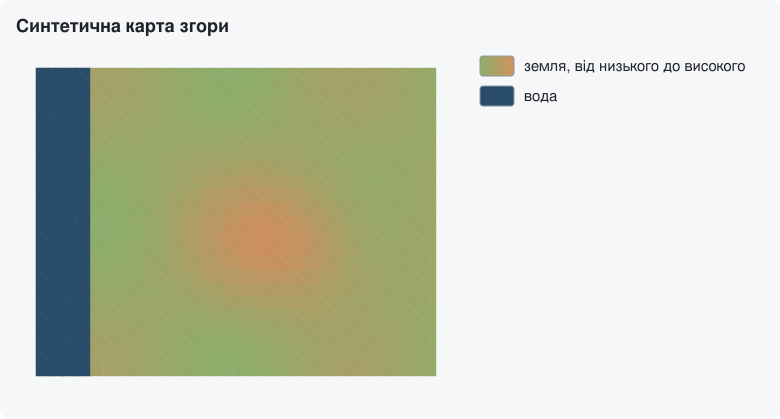

# Файли рівня і системи координат {#the-level-files-and-frames}

`<out>/<map>/<map>.glb` (рівень: 3D-модель землі) і `<map>.json` поруч з ним. Файл
glb записується в `<map>.glb.part` і перейменовується, коли готовий.

| Частина | Що це |
|---|---|
| `ground:<map>` | карта висот ландшафту як сітка, найбільше `--max-grid` відліків з кожного боку (за замовчуванням 1024: близько 2 мільйонів трикутників) |
| `water:<map>` | річки, озера і море: плоскі чотирикутники на висоті води, по одному на клітинку сітки, якщо достатньо відліків карти висот під водою (третина з маскою води карти, половина без неї) |
| `ground:<map> towns` | забудовані контури міст і сіл, накладені на 1,5 м над землею |

JSON містить **кути карти і коробку широти/довготи** (`corners`, `extent`), як їх
знайдено (`georeference`), налаштування висот (`heightMul`, `SeaLevel`), ігрову зону в
метрах гри (`playArea`), систему координат і її початок (`frame`, `geo`), кількість
трикутників і будь-які `notes`.

## Системи координат {#frames}

Дві системи координат, `--frame`:

- `enu` (за замовчуванням): метри на схід, висота над рівнем моря, північ від початку
  на дотичній площині WGS-84: плоска карта, на яку 3DHeat Watcher кладе запис Tacview з
  IL-2 (x — схід, y — висота, z — північ, малюється з дзеркальним z). Файл glb зберігає
  (схід, висота, -північ). Перетворіть, вказавши `--origin <lat> <lon>` зі значенням
  `geo` запису (опорна точка його сесії), і запис ляже на рівень без жодного кроку
  розміщення; без цього параметра початком стає центр карти, а `geo` у JSON каже, яка саме.
- `game`: власні метри гри, як їх мають файли місій: x — північ від південного краю,
  y — висота гри, z — схід від західного краю (праворуч, як є, тож glb = (x, y, z)).
  Карти, які неможливо розмістити на Землі, записуються в цій системі незалежно від
  запиту, з приміткою.

Рівень — це двійковий glTF з іменованими частинами, як і кожен рівень 3DHeat; сторінка
[Рівні](https://holdi601.github.io/3DHeat/levels.html) переглядача пояснює, як він
завантажується.
