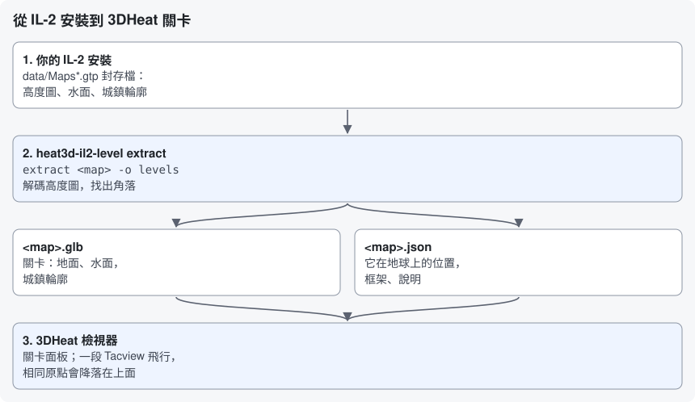

# 3DHeat IL-2 {#dheat-il-2}

**這是什麼？** 一個小程式，會把 **IL-2 Sturmovik: Great Battles** 的地圖，從**你自己的安裝**中讀取出來，轉換成 3D 模型（關卡）。你可以在 [3DHeat](https://github.com/Holdi601/3DHeat) 檢視器中飛越它們（[說明文件](https://holdi601.github.io/3DHeat/)）：丘陵、河流、湖泊、海洋與城鎮，都依其在地球上的實際位置放置。另一款封存檔中隱藏了檔案表的 IL-2 遊戲，則會在封存檔允許的範圍內被讀取（[詳情](archives-without-table.md)）。

**為什麼要用它？** 在遊戲自己的地圖上檢視你的 IL-2 飛行。

**範例：** `heat3d-il2-level extract <map> -o levels` ->
`levels/<map>/<map>.glb`（關卡）+ `<map>.json`（它在地球上的位置）。高度圖是高度的網格，類似一張地形浮雕圖；Tacview 錄製則是 Tacview 寫出的飛行檔案。

它的用途包括：

- **在遊戲自己的地圖上飛行。** IL-2 的 Tacview 錄製，若由 3DHeat Watcher 以相同的原點轉換，就會落在關卡上，不需要擺放步驟。
- **一次處理所有地圖。** `extract --all` 會寫出找到的每一張地圖；共用同一高度圖的季節只寫入一次。
- **在地球上的位置。** 每個關卡的 `.json` 都帶有其四個角落與經緯度方框，以及它們是如何找到的。



## 快速開始 {#quick-start}

第一次使用命令列？請先閱讀[開始之前](before-you-start.md)。
在你複製或解壓縮的資料夾中執行以下指令：

```bash
python -m pip install -e .                         # installs the heat3d-il2-level command
python -m pip install -e .[fast]                            # with numba: decoding 20 to 50 times faster
heat3d-il2-level list                              # every map found, with its latitude/longitude box
heat3d-il2-level extract <map> -o levels           # one map (names as `list` prints them, wildcards allowed)
heat3d-il2-level extract --all -o levels           # every map
```

你應該會看到 `list` 每張地圖一行，以及 `extract` 輸出的 `ok ...`。
接著在檢視器的背景／關卡面板中載入 `levels/<map>/<map>.glb`（[關卡](https://holdi601.github.io/3DHeat/levels.html)）。

它所寫出的關卡是由遊戲的資料建成的，只能**留在你的電腦上**；請勿發布（[條款](terms.md)）。

每個遊戲讀取器都是一個獨立的小專案，有自己的授權檔案、發行版本和問題追蹤，因此可以單獨安裝、更新、維護——或應權利人的要求撤下——而不影響檢視器或其他工具。

## 頁面 {#pages}

| 頁面 | 內容 |
|---|---|
| [開始之前](before-you-start.md) | Python、終端機、第一次執行 |
| [尋找地圖：list](list.md) | 安裝位置的尋找方式，`list` 會印出什麼 |
| [建立關卡：extract](extract.md) | 每個選項、逐步說明、範例 |
| [關卡檔案與座標系](output.md) | `.glb` 的各部分、`.json`、`enu` 與 `game` 座標系 |
| [檔案如何被讀取](reading.md) | 封存檔、高度圖編碼、水域、城鎮、地標擬合 |
| [沒有檔案表的封存檔](archives-without-table.md) | 第二款遊戲，在其封存檔允許的範圍內讀取 |
| [速度、測試與條款](terms.md) | numba、測試、讀取什麼以及不隨附什麼、授權 |
| [指令參考](../cli-reference.md) | 每個選項，由程式碼產生 |
| [維護這些文件](maintaining.md) | 發行檢查清單 |

## 相關連結 {#related}

- 3DHeat 檢視器：[github.com/Holdi601/3DHeat](https://github.com/Holdi601/3DHeat)，
  說明文件位於 [holdi601.github.io/3DHeat](https://holdi601.github.io/3DHeat/)。
- 這些關卡的遙測：[3DHeat Watcher](https://holdi601.github.io/3DHeat-Watcher/)
  會轉換 IL-2 的 Tacview 錄製；檢視器的檔案格式（包括每場對戰一個檔案的容器）記載於
  [每場對戰一個檔案（.3dheat）](https://holdi601.github.io/3DHeat/container.html)。

## 3DHeat 工具 {#the-3dheat-tools}

| 工具 | 功能 | 程式碼 | 文件 |
|---|---|---|---|
| 3DHeat 檢視器 | 顯示資料：熱圖、賽車分析、對戰回顧 | [3DHeat](https://github.com/Holdi601/3DHeat) | [文件](https://holdi601.github.io/3DHeat/) |
| GameFiles | 遊戲自身檔案中的關卡與賽道 | [3DHeat-GameFiles](https://github.com/Holdi601/3DHeat-GameFiles) | [文件](https://holdi601.github.io/3DHeat-GameFiles/) |
| GameCapture | 圈速遙測，以及從遊戲影片重建的關卡 | [3DHeat-GameCapture](https://github.com/Holdi601/3DHeat-GameCapture) | [文件](https://holdi601.github.io/3DHeat-GameCapture/) |
| Unreal Exporter | Unreal Editor 外掛：將關卡匯出為一個 `.glb` | [3DHeat-UnrealExporter](https://github.com/Holdi601/3DHeat-UnrealExporter) | [文件](https://holdi601.github.io/3DHeat-UnrealExporter/) |
| CS2 | Counter-Strike 2 的對戰與地圖 | [3DHeat-CS2](https://github.com/Holdi601/3DHeat-CS2) | [文件](https://holdi601.github.io/3DHeat-CS2/) |
| Watcher | 在你遊玩時，記錄遊戲所發布的內容 | [3DHeat-Watcher](https://github.com/Holdi601/3DHeat-Watcher) | [文件](https://holdi601.github.io/3DHeat-Watcher/) |
| Ext-WarThunder | War Thunder 錄影 | [3DHeat-Ext-WarThunder](https://github.com/Holdi601/3DHeat-Ext-WarThunder) | [文件](https://holdi601.github.io/3DHeat-Ext-WarThunder/) |
| Ext-WoT | World of Tanks 錄影 | [3DHeat-Ext-WoT](https://github.com/Holdi601/3DHeat-Ext-WoT) | [文件](https://holdi601.github.io/3DHeat-Ext-WoT/) |
| Ext-WoWs | World of Warships 錄影 | [3DHeat-Ext-WoWs](https://github.com/Holdi601/3DHeat-Ext-WoWs) | [文件](https://holdi601.github.io/3DHeat-Ext-WoWs/) |
| Ext-Squad | Squad 伺服器對戰 | [3DHeat-Ext-Squad](https://github.com/Holdi601/3DHeat-Ext-Squad) | [文件](https://holdi601.github.io/3DHeat-Ext-Squad/) |
| Ext-DCS | 以 3D 關卡呈現的 DCS World 地圖 | [3DHeat-Ext-DCS](https://github.com/Holdi601/3DHeat-Ext-DCS) | [文件](https://holdi601.github.io/3DHeat-Ext-DCS/) |
| Ext-IL2 | 以 3D 關卡呈現的 IL-2 Sturmovik 地圖 | [3DHeat-Ext-IL2](https://github.com/Holdi601/3DHeat-Ext-IL2) | [文件](https://holdi601.github.io/3DHeat-Ext-IL2/) |
