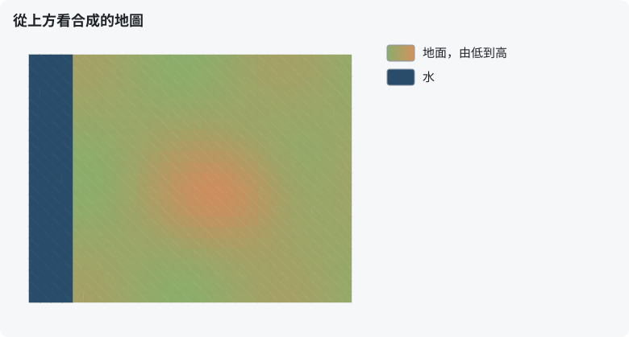

# 關卡檔案與座標系 {#the-level-files-and-frames}

`<out>/<map>/<map>.glb`（關卡：地面的 3D 模型）以及其旁邊的 `<map>.json`。glb 會先寫入 `<map>.glb.part`，完成後再更名。

| 部分 | 內容 |
|---|---|
| `ground:<map>` | 高度圖的地形，以網格表示，每邊最多 `--max-grid` 個取樣（預設 1024：約 200 萬個三角形） |
| `water:<map>` | 河流、湖泊與海洋：位於水面高度的平面四邊形，每個網格單元一個，只要其高度圖取樣中有足夠多位於水下即可（使用地圖的水域遮罩時為三分之一，不使用時為一半） |
| `ground:<map> towns` | 城鎮與村莊的建成區輪廓，覆蓋在地面上方 1.5 公尺處 |

JSON 保存地圖的**角落與經緯度方框**（`corners`、`extent`）、它們是如何找到的（`georeference`）、高度設定（`heightMul`、`SeaLevel`）、遊戲公尺中的遊玩範圍（`playArea`）、座標系及其原點（`frame`、`geo`）、三角形數量，以及任何 `notes`。

## 座標系 {#frames}

兩種座標系，由 `--frame` 指定：

- `enu`（預設）：以 WGS-84 切平面上某一原點為中心的東向公尺、海平面以上的高度、北向公尺：即 3DHeat Watcher 放置 IL-2 Tacview 錄製的平面地圖（x 朝東、y 為高度、z 朝北，並以 z 鏡像繪製）。glb 保存的是（東、高度、-北）。以錄製的 `geo`（其工作階段的參考點）作為 `--origin <lat> <lon>`，即可進行轉換，錄製會落在關卡上，不需要擺放步驟；若未指定，則地圖的中心即為原點，而 JSON 中的 `geo` 會說明是哪一點。
- `game`：任務檔案所使用的遊戲自身公尺：x 從南邊緣算起朝北，y 為遊戲的高度，z 從西邊緣算起朝東（保持原樣的右手座標系，因此 glb = (x, y, z)）。無法放置在地球上的地圖，無論要求為何，都會以此座標系寫出，並附上註記。

關卡是具有具名部分的 glTF 二進位檔，與每個 3DHeat 關卡相同；檢視器的[關卡](https://holdi601.github.io/3DHeat/levels.html)頁面說明了如何載入它們。
