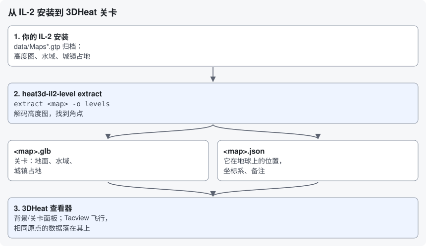

# 3DHeat IL-2 {#dheat-il-2}

**这是什么？** 一个小程序，读取**你自己安装的** **IL-2 Sturmovik: Great Battles**（游戏名称保持英文）中的地图，并把它们转换成 3D 模型（关卡），供你在 [3DHeat](https://github.com/Holdi601/3DHeat) 查看器中飞越（[文档](https://holdi601.github.io/3DHeat/)）：山丘、河流、湖泊、海洋和城镇，都按它们在地球上的真实位置摆放。第二款 IL-2 游戏的归档会隐藏其文件表，本工具会在归档允许的范围内读取它（[详情](archives-without-table.md)）。

**我为什么要用它？** 在游戏自己的地图上查看你的 IL-2 飞行。

**示例：** `heat3d-il2-level extract <map> -o levels` ->
`levels/<map>/<map>.glb`（关卡）+ `<map>.json`（它在地球上的位置）。高度图是一个高度网格，类似地形浮雕图；Tacview 录制则是 Tacview 写出的一次飞行文件。

它的用途包括：

- **在游戏自己的地图上飞行。** 3DHeat Watcher 以相同的原点转换 IL-2 的 Tacview 录制，之后它会直接落在关卡上，无需摆放步骤。
- **一次处理所有地图。** `extract --all` 会写出找到的每一张地图；共享同一高度图的季节版本只写一次。
- **在地球上的位置。** 每个关卡的 `.json` 都记录了它的角点和纬度/经度范围，以及这些数据是如何得到的。



## 快速开始 {#quick-start}

第一次使用命令行？请先阅读 [开始之前](before-you-start.md)。
在你克隆或解压的文件夹中运行以下命令：

```bash
python -m pip install -e .                         # 安装 heat3d-il2-level 命令
python -m pip install -e .[fast]                            # 加装 numba：解码速度快 20 到 50 倍
heat3d-il2-level list                              # 找到的每张地图，以及它的纬度/经度范围
heat3d-il2-level extract <map> -o levels           # 一张地图（名称与 list 打印的一致，可以使用通配符）
heat3d-il2-level extract --all -o levels           # 每一张地图
```

你应该会看到 `list` 为每张地图输出一行，`extract` 输出 `ok ...`。
然后在查看器的 [背景/关卡面板](https://holdi601.github.io/3DHeat/levels.html) 中加载 `levels/<map>/<map>.glb`。

它生成的关卡由游戏数据构建，因此它们**只保存在你的电脑上**；切勿发布（[条款](terms.md)）。

每个游戏读取器都是一个独立的小项目，有自己的许可证文件、发布版本和问题跟踪，因此可以单独安装、更新、维护——或应权利人的要求撤下——而不影响查看器或其他工具。

## 页面 {#pages}

| 页面 | 内容 |
|---|---|
| [开始之前](before-you-start.md) | Python、终端和第一次运行 |
| [查找地图：list](list.md) | 安装位置如何被找到，`list` 打印什么 |
| [构建关卡：extract](extract.md) | 每个选项、逐步说明和示例 |
| [关卡文件与坐标系](output.md) | `.glb` 的各个部分、`.json`，以及 `enu` 和 `game` 坐标系 |
| [如何读取文件](reading.md) | 归档、高度图编解码器、水域、城镇、地标拟合 |
| [没有文件表的归档](archives-without-table.md) | 第二款游戏，在其归档允许的范围内读取 |
| [速度、测试与条款](terms.md) | numba、测试、读取什么以及不随附什么、许可证 |
| [命令参考](../cli-reference.md) | 每个选项，由代码生成 |
| [维护这些文档](maintaining.md) | 发布检查清单 |

## 相关内容 {#related}

- 3DHeat 查看器：[github.com/Holdi601/3DHeat](https://github.com/Holdi601/3DHeat)，
  文档位于 [holdi601.github.io/3DHeat](https://holdi601.github.io/3DHeat/)。
- 这些关卡的遥测数据：[3DHeat Watcher](https://holdi601.github.io/3DHeat-Watcher/)
  转换 IL-2 的 Tacview 录制；查看器的文件格式，包括一场对局一个文件的容器，见
  [一场对局一个文件（.3dheat）](https://holdi601.github.io/3DHeat/container.html)。

## 3DHeat 工具 {#the-3dheat-tools}

| 工具 | 作用 | 代码 | 文档 |
|---|---|---|---|
| 3DHeat 查看器 | 显示数据：热力图、赛车分析、对局回顾 | [3DHeat](https://github.com/Holdi601/3DHeat) | [文档](https://holdi601.github.io/3DHeat/) |
| GameFiles | 从游戏自身文件中提取关卡和赛道 | [3DHeat-GameFiles](https://github.com/Holdi601/3DHeat-GameFiles) | [文档](https://holdi601.github.io/3DHeat-GameFiles/) |
| GameCapture | 圈速遥测，以及从游戏录像重建的关卡 | [3DHeat-GameCapture](https://github.com/Holdi601/3DHeat-GameCapture) | [文档](https://holdi601.github.io/3DHeat-GameCapture/) |
| Unreal Exporter | 虚幻编辑器插件：把一个关卡导出为一个 `.glb` | [3DHeat-UnrealExporter](https://github.com/Holdi601/3DHeat-UnrealExporter) | [文档](https://holdi601.github.io/3DHeat-UnrealExporter/) |
| CS2 | 反恐精英 2 的录像和地图 | [3DHeat-CS2](https://github.com/Holdi601/3DHeat-CS2) | [文档](https://holdi601.github.io/3DHeat-CS2/) |
| Watcher | 在你游玩时记录游戏公开的数据 | [3DHeat-Watcher](https://github.com/Holdi601/3DHeat-Watcher) | [文档](https://holdi601.github.io/3DHeat-Watcher/) |
| Ext-WarThunder | 战争雷霆的录像 | [3DHeat-Ext-WarThunder](https://github.com/Holdi601/3DHeat-Ext-WarThunder) | [文档](https://holdi601.github.io/3DHeat-Ext-WarThunder/) |
| Ext-WoT | 坦克世界的录像 | [3DHeat-Ext-WoT](https://github.com/Holdi601/3DHeat-Ext-WoT) | [文档](https://holdi601.github.io/3DHeat-Ext-WoT/) |
| Ext-WoWs | 战舰世界的录像 | [3DHeat-Ext-WoWs](https://github.com/Holdi601/3DHeat-Ext-WoWs) | [文档](https://holdi601.github.io/3DHeat-Ext-WoWs/) |
| Ext-Squad | Squad 服务器录像 | [3DHeat-Ext-Squad](https://github.com/Holdi601/3DHeat-Ext-Squad) | [文档](https://holdi601.github.io/3DHeat-Ext-Squad/) |
| Ext-DCS | DCS World 地图，作为 3D 关卡 | [3DHeat-Ext-DCS](https://github.com/Holdi601/3DHeat-Ext-DCS) | [文档](https://holdi601.github.io/3DHeat-Ext-DCS/) |
| Ext-IL2 | IL-2 Sturmovik 地图，作为 3D 关卡 | [3DHeat-Ext-IL2](https://github.com/Holdi601/3DHeat-Ext-IL2) | [文档](https://holdi601.github.io/3DHeat-Ext-IL2/) |
