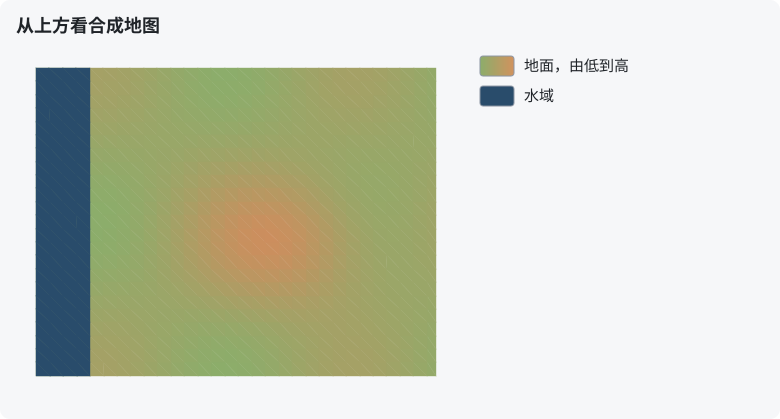

# 关卡文件与坐标系 {#the-level-files-and-frames}

`<out>/<map>/<map>.glb`（关卡：地面的 3D 模型）以及它旁边的 `<map>.json`。glb 会先写入 `<map>.glb.part`，完成后再重命名。

| 部分 | 内容 |
|---|---|
| `ground:<map>` | 以网格表示的地形高度图，每边最多 `--max-grid` 个采样点（默认 1024：约 200 万个三角形） |
| `water:<map>` | 河流、湖泊和海洋：位于水面高度的平面四边形，每个网格单元一个，只要其中足够多的高度图采样点位于水下（使用地图的水域蒙版时为三分之一，不使用时为一半） |
| `ground:<map> towns` | 城镇和村庄的建成区轮廓，覆盖在地面上方 1.5 米 |

JSON 保存了地图的**角点和纬度/经度范围**（`corners`、`extent`）、这些数据是如何得到的（`georeference`）、高度设置（`heightMul`、`SeaLevel`）、以游戏米制表示的游戏区域（`playArea`）、坐标系及其原点（`frame`、`geo`）、三角形数量，以及所有 `notes`（备注）。

## 坐标系 {#frames}

`--frame` 有两种坐标系：

- `enu`（默认）：以东向米、海平面以上的海拔高度、北向米表示，原点位于 WGS-84 切平面上：即 3DHeat Watcher 放置 IL-2 Tacview 录制的平面地图（x 向东，y 为海拔，z 向北，绘制时 z 轴镜像）。glb 存储的是（东，海拔，-北）。使用 `--origin <lat> <lon>`（设为录制的 `geo`，即其会话的参考点）进行转换，录制就会落在关卡上，无需摆放步骤；如果不指定，地图的中心即为原点，而 JSON 中的 `geo` 会说明是哪一个。
- `game`：任务文件中使用的游戏自身米制：x 为北，从南边缘开始计算；y 为游戏中的高度；z 为东，从西边缘开始计算（保持其原样的右手坐标系，因此 glb = (x, y, z)）。无法在地球上摆放的地图，无论请求什么，都会以此坐标系写出，并附有说明。

与每个 3DHeat 关卡一样，该关卡是带有命名部分的 glTF 二进制文件；查看器的 [关卡](https://holdi601.github.io/3DHeat/levels.html) 页面说明了如何加载它们。
